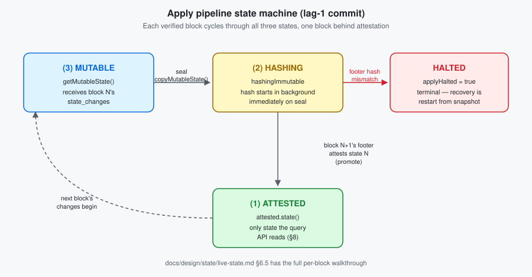

# `state-management-hashgraph` plugin

> **Status:** *Beta, partial.* Lifecycle, apply, and snapshot restore are implemented. Snapshot
> creation and the gRPC query API are not yet, see Roadmap.

Live Hashgraph state on the Block Node. Subscribes to verified block-stream notifications and
applies their `state_changes` into an in-memory `VirtualMapState`, using the same lifecycle
types the consensus node uses.

## How it works

The apply pipeline runs each block through three state versions, one block behind attestation
("lag-1 commit"):

|   Step    |                                                                                                                                       What happens                                                                                                                                        |
|-----------|-------------------------------------------------------------------------------------------------------------------------------------------------------------------------------------------------------------------------------------------------------------------------------------------|
| Subscribe | Registers as a `BlockNotificationHandler`; only `VerificationNotification.success == true` blocks are applied.                                                                                                                                                                            |
| Catch up  | On the catch-up thread, at `start()` and whenever a live block arrives ahead of the next expected one: replays history from the next expected block to the latest, one block at a time. Ready only once the latest block is reached; a stalled sweep is re-driven by the next live block. |
| Apply     | The next expected block is applied inline on the notification thread. A block ahead of it is dropped and triggers a catch-up, so that thread never reads history. Nothing is buffered.                                                                                                    |
| Restore   | On `start()`, scans `snapshotRecentPath` for the highest-numbered directory, loads it, then checks the loaded state's `BlockStreamInfo.block_number` against the directory name before trusting it.                                                                                       |

Full per-block walkthrough: `docs/design/state/live-state.md` §6.

## Storage encoding

All values written to `BinaryState` are the raw payload of the oneof-selected field of each
`com.hedera.hapi.block.stream.output` wrapper, the same bytes the consensus node stores:

- Singletons store the payload of `SingletonUpdateChange`. A partial update is spliced onto the
  prior value first (see `docs/design/state/live-state.md` §7).
- KV entries use the payload of `MapChangeKey` as the key and of `MapChangeValue` as the value.
- Queues store the payload of each `QueuePushChange`.

## Configuration

Bound under `@ConfigData("state.management")` in `StateManagementConfig`, see
`docs/design/state/live-state.md` §4 for the full property table.

There is no `enabled` flag. Block-Node plugins are active whenever their jar is on the
classpath; opt-in lives in the deployment manifest.

## Failure modes

|                                  Failure                                   |                                                                              Behaviour                                                                              |
|----------------------------------------------------------------------------|---------------------------------------------------------------------------------------------------------------------------------------------------------------------|
| No snapshot directories at startup                                         | Genesis; this is the normal first boot, not a failure.                                                                                                              |
| Snapshot root unlistable, highest directory unreadable or fails self-check | Halt.                                                                                                                                                               |
| No snapshot and first block is N > 0 (no seed state)                       | Halt with a distinct "No seed state" log; not counted as a hash mismatch. Supply a snapshot.                                                                        |
| Footer hash mismatch (`startOfBlockStateRootHash`)                         | Halt; `hashMismatchTotal` incremented.                                                                                                                              |
| Digest-length mismatch (e.g. SHA-256 footer vs. this build's SHA-384)      | Halt, logged distinctly from a genuine divergence.                                                                                                                  |
| Legacy field-2 token-association encoding                                  | Halt with a distinct error, not a generic hash mismatch.                                                                                                            |
| Malformed `state_changes` item                                             | That block's apply aborts; plugin does not advance past it.                                                                                                         |
| Partial update with no prior value                                         | Halt (`PARTIAL_WITHOUT_BASELINE`).                                                                                                                                  |
| Verification gap (block ahead of the next expected)                        | Block dropped; the catch-up thread fetches the missing blocks from `historicalBlockProvider` one at a time. Retried on the next notification if history lacks them. |

A restored snapshot is trusted as a previously stored attested state. Its root hash is first
checked against the chain by the next block's footer, so a node that restores state but ingests
no further blocks relies on snapshot integrity (`docs/design/state/live-state.md` §6.2).

All halts are terminal: recovery is a restart from the last good snapshot, not a live retry.
Full table and recovery semantics: `docs/design/state/live-state.md` §10.

## Reading the attested state

Readers call `reserveAttested()` and read from the returned `ReservedState`, closing it when
done. The reservation keeps the state alive if a newer block is attested meanwhile. It returns
`null` while nothing is attested.

## Limitations

- No snapshot creation yet. The plugin restores an externally-produced snapshot; it never
  writes one itself.
- No gRPC query API yet.
- Hash-mismatch recovery requires a restart; there is no automatic rewind/replay.
- Catch-up applies one block at a time from historical storage; very large catch-up windows
  delay `ready=true` proportionally.
- `StateManagementConfigExtension` also declares `MerkleDbConfig`/`VirtualMapConfig`, since the
  swirlds jars don't self-register them, see that class's javadoc.

## Roadmap

- Snapshot creation (periodic, with retention/pruning).
- `StateService` gRPC query API (`getKV`/`getSingleton`/`getQueue`).
- Hash-mismatch recovery protocol.
- Merkle proof RPC exposure.
