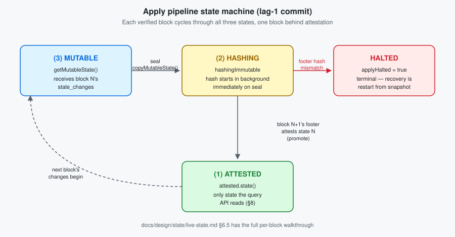

# `state-management-hashgraph` plugin

> **Status:** *Beta, partial.* Lifecycle, apply, and snapshot restore are implemented. Snapshot
> creation and the gRPC query API are not yet, see Roadmap.

Live Hashgraph state on the Block Node. Subscribes to verified block-stream notifications and
applies their `state_changes` into an in-memory `VirtualMapState`, using the same lifecycle
types the consensus node uses.

## How it works

The apply pipeline runs each block through three state versions, one block behind attestation
("lag-1 commit"):

|   Step    |                                                                                            What happens                                                                                             |
|-----------|-----------------------------------------------------------------------------------------------------------------------------------------------------------------------------------------------------|
| Subscribe | Registers as a `BlockNotificationHandler`; only `VerificationNotification.success == true` blocks are staged.                                                                                       |
| Catch up  | One-shot on `start()`: fills the gap between the attested block and `historicalBlockProvider`'s latest, in batches.                                                                                 |
| Apply     | A single apply-worker thread drains staged blocks in order the moment one arrives, no timer.                                                                                                        |
| Restore   | On `start()`, scans `snapshotRecentPath` for the highest-numbered directory, loads it, then checks the loaded state's `BlockStreamInfo.block_number` against the directory name before trusting it. |

Full per-block walkthrough: `docs/design/state/live-state.md` §6.

## Storage encoding

All values written to `BinaryState` are the raw payload of the oneof-selected field of each
`com.hedera.hapi.block.stream.output` wrapper, the same bytes the consensus node stores:

- Singletons store the payload of `SingletonUpdateChange`.
- KV entries use the payload of `MapChangeKey` as the key and of `MapChangeValue` as the value.
- Queues store the payload of each `QueuePushChange`.

## Configuration

Bound under `@ConfigData("state.management")` in `StateManagementConfig`, see
`docs/design/state/live-state.md` §4 for the full property table.

There is no `enabled` flag. Block-Node plugins are active whenever their jar is on the
classpath; opt-in lives in the deployment manifest.

## Failure modes

|                                Failure                                |                                                 Behaviour                                                 |
|-----------------------------------------------------------------------|-----------------------------------------------------------------------------------------------------------|
| No snapshot directories at startup                                    | Genesis; this is the normal first boot, not a failure.                                                    |
| Highest snapshot directory unreadable, or fails its self-check        | Halt.                                                                                                     |
| Footer hash mismatch (`startOfBlockStateRootHash`)                    | Halt; `hashMismatchTotal` incremented.                                                                    |
| Digest-length mismatch (e.g. SHA-256 footer vs. this build's SHA-384) | Halt, logged distinctly from a genuine divergence.                                                        |
| Legacy field-2 token-association encoding                             | Halt with a distinct error, not a generic hash mismatch.                                                  |
| Malformed `state_changes` item                                        | That block's apply aborts; plugin does not advance past it.                                               |
| Gap in `pendingBlocks`                                                | Retried from `historicalBlockProvider` after `gapRetryDelaySeconds`; buffer capped at `pendingBlocksMax`. |

All halts are terminal: recovery is a restart from the last good snapshot, not a live retry.
Full table and recovery semantics: `docs/design/state/live-state.md` §10.

## Limitations

- No snapshot creation yet. The plugin restores an externally-produced snapshot; it never
  writes one itself.
- No gRPC query API yet.
- Hash-mismatch recovery requires a restart; there is no automatic rewind/replay.
- Catch-up is sequential and synchronous within batches; very large catch-up windows delay
  `ready=true` proportionally.
- `StateManagementConfigExtension` also declares `MerkleDbConfig`/`VirtualMapConfig`, since the
  swirlds jars don't self-register them, see that class's javadoc.

## Roadmap

- Snapshot creation (periodic, with retention/pruning).
- `StateService` gRPC query API (`getKV`/`getSingleton`/`getQueue`).
- Hash-mismatch recovery protocol.
- Merkle proof RPC exposure.
