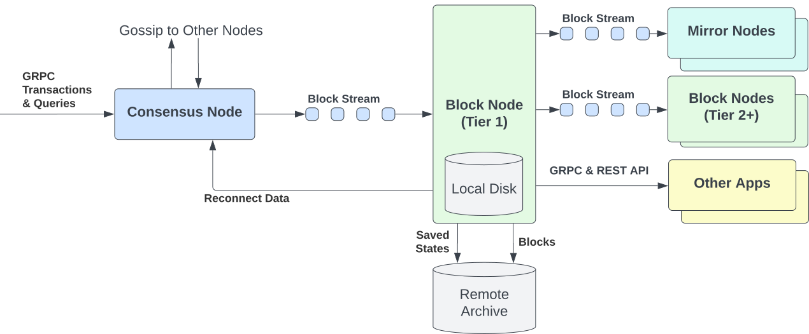

# Hiero Block Node

The Block Node receives block streams from Consensus Nodes, stores blocks and network state, and serves block data to downstream subscribers such as Mirror Nodes.

## Documentation

- **Overview**
  - [Block Node overview](overview/block-node-overview.md)
  - [Block Node introduction](overview/block-node-introduction.md)
  - [Docker Compose quickstart](overview/docker-compose-quickstart.md)
- **Deploy**
  - [Hardware specifications](deploy/block-node-hardware-specifications.md)
  - [Production deployment guide](deploy/production-guide/README.md)
  - [Solo Provisioner single-node Kubernetes](deploy/solo-weaver-single-node-k8s-deployment.md)
  - [Manual single-node Kubernetes](deploy/single-node-k8s-deployment.md)
  - [Version compatibility](deploy/version-compatibility.md)
  - [Zero-downtime upgrade](deploy/zero-downtime-upgrade.md)
- **Configure**
  - [Configuration reference](configure/configuration.md)
  - [On-chain registration](configure/block-node-on-chain-registration.md)
  - [Network ports and protocols](configure/network-ports-and-protocols.md)
- **Connect**
  - [Consensus Node to Block Node](connect/consensus-node-to-block-node-configuration.md)
  - [Mirror Node to Block Node](connect/connecting-a-mirror-node-to-a-block-node.md)
  - [Local Node integration](connect/local-node-block-node-integration.md)
  - [Mirror Node integration guide](connect/mirror-node-integration.md)
  - [API quickstart](connect/api-quickstart.md)
- **Operate**
  - [Metrics](operate/metrics.md)
  - [Logging](operate/logging.md)
  - [Troubleshooting](operate/troubleshooting.md)
  - [Reset and upgrade](operate/resetting-and-upgrading-the-block-node.md)
  - [Test with simulator](operate/testing-a-deployed-block-node-using-the-simulator.md)
  - [Load testing](operate/load-testing-a-deployed-block-node-using-solo-and-nlg.md)
  - [Disaster recovery](operate/disaster-recovery/README.md)
- **Block stream cutover**
  - [Record stream to block stream migration](cutover/record-stream-to-block-stream-migration.md)
  - [WRB cutover preparation](cutover/preparing-your-block-node-for-wrb-cutover.md)
  - [Solo Provisioner WRB runbook](cutover/sp-wrb-bn-operator-runbook.md)
  - [WRB CLI runbook](cutover/wrb-cli-runbook.md)
  - [Cutover process and timeline](cutover/Cutover-Process.md)
- **Reference**
  - [Glossary](reference/glossary.md)
  - [FAQs](reference/faq/README.md)
- **Development**
  - [Architecture overview](development/architecture/architecture-overview.md)
  - [Design docs](../design/README.md)
  - [Simulator](../simulator/README.md)
