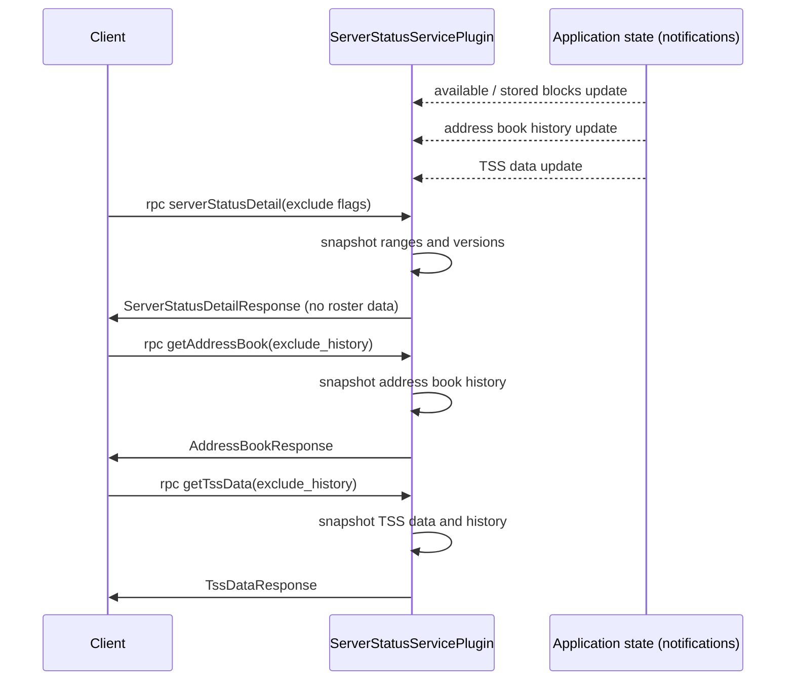

# ServerStatus API Design

## Table of Contents

1. [Purpose](#purpose)
2. [Goals](#goals)
3. [Terms](#terms)
4. [Entities](#entities)
5. [Design](#design)
6. [Sequence Diagram](#sequence-diagram)
7. [API Messages](#api-messages)
8. [Compatibility and Rollout](#compatibility-and-rollout)
9. [Configuration](#configuration)
10. [Metrics](#metrics)
11. [Exceptions](#exceptions)
12. [Acceptance Tests](#acceptance-tests)
13. [Open Questions](#open-questions)

## Purpose

The status APIs of the `BlockNodeService` let a client learn what a Block Node can serve and how it is configured:
which blocks it has, which software it runs, and the roster data (address book and TSS) needed to verify blocks.
Clients are Consensus Nodes, Mirror Nodes, other Block Nodes (backfill and roster bootstrap) and operator tooling.

`serverStatusDetail` has grown to carry several large values that change rarely, namely the address book, its history
and the TSS data. Every caller pays for them even when it only wants block ranges. This document describes how those
values move to dedicated calls, and how `serverStatusDetail` becomes cheap and selectable.

The protobuf definition lives in `protobuf-sources/src/main/proto/block-node/api/node_service.proto`.

## Goals

1. Keep `serverStatus` as the small, always cheap call for the block range summary.
2. Make `serverStatusDetail` return only block-serving detail, and let the caller leave out the parts it does not need.
3. Provide `getAddressBook` and `getTssData` so roster data is requested explicitly.
4. Let the roster calls return only the most recent values, or the full history by block range.
5. Roll the change out without breaking Block Nodes and clients on older versions.

## Terms

<dl>
<dt>Client</dt><dd>The consumer of the API: a Consensus Node, a Mirror Node, another Block Node or operator tooling.</dd>
<dt>Available ranges</dt><dd>Block ranges this node can serve to a client.</dd>
<dt>Stored ranges</dt><dd>Block ranges this node has persisted.</dd>
<dt>Address book</dt><dd>RSA node address book data: node ids and RSA public keys used to verify record-based wrapped blocks.</dd>
<dt>TSS data</dt><dd>Ledger id, WRAPS verification key and TSS roster information used to verify TSS block proofs.</dd>
<dt>History</dt><dd>The roster values by block range (for example <code>RangedAddressBookHistory</code>), ordered by block number, as opposed to only the latest value.</dd>
</dl>

## Entities

### ServerStatusServicePlugin

Implements the `BlockNodeService` RPCs and registers them on the configured gRPC port (the shared `server.port` by
default). It does not read roster data from disk or from other plugins while serving a request. It keeps the latest
values in volatile fields and answers each request from a snapshot of them.

### Application state notifications

The plugin registers an application state notification handler and updates its fields whenever the values change:

- available blocks and stored blocks,
- TSS data (latest value only today),
- the ranged address book history.

The latest address book returned today is derived from the history: the address book of its last era.

### Throttling

Each RPC has its own per-client throttle settings and its own node-wide concurrency ceiling, as described in
[API Throttling](./api-throttling.md). `serverStatus` and `serverStatusDetail` are configured today. The new RPCs get
their own settings.

## Design

### serverStatus (unchanged)

Returns the first and last available block, the next expected block and whether only the latest state is kept. It is the
call a client should make before requesting block data.

### serverStatusDetail (changed)

Today the response contains version information, available ranges, stored ranges, TSS data, the latest address book and
the address book history.

After this change:

1. The request is a new `ServerStatusDetailRequest` with three flags. A flag set to `true` leaves that part out:
   `exclude_versions`, `exclude_available_ranges`, `exclude_stored_ranges`.
2. The response contains only `version_information`, `available_ranges` and `stored_ranges`.
3. TSS data, the address book and the address book history are removed from this response. The removed field numbers are
   marked `reserved` so they are never reused.
4. An empty request returns every remaining part, so a client that sends nothing keeps working.

Backfill reads only the available ranges, so it can set the other two flags and avoid the version and stored range
payload.

### getAddressBook (new)

Returns the RSA address book from the application state.

1. `exclude_history = true`: the response contains only `node_address_book`, the address book of the most recent era.
2. `exclude_history = false` (default): the response also contains `ranged_address_book_history`, the books by block
   range.
3. If no address book is known yet, the response is valid and the fields are empty. It is not an error.

### getTssData (new)

Returns the TSS data from the application state.

1. `exclude_history = true`: the response contains only `tss_data`, the latest TSS data.
2. `exclude_history = false` (default): the response also contains `ranged_tss_data_history`, ordered by block number.
3. If no TSS data is known yet, the response is valid and the fields are empty.

The application state currently keeps only the latest TSS data. Returning history needs a ranged TSS history to exist in
the application state, tracked as its own task. See [Open Questions](#open-questions).

### Consistency

Each call reads one snapshot of the volatile fields it needs, so a single response is internally consistent. Two separate
calls (for example `getAddressBook` and `getTssData`) are not a single snapshot. Clients that need both must tolerate a
change between them.

## Sequence Diagram



## API Messages

```protobuf
message ServerStatusDetailRequest {
    // If true, the response leaves out version_information.
    bool exclude_versions = 1;
    // If true, the response leaves out available_ranges.
    bool exclude_available_ranges = 2;
    // If true, the response leaves out stored_ranges.
    bool exclude_stored_ranges = 3;
}

message ServerStatusDetailResponse {
    reserved 3, 4, 6; // tss_data, node_address_book, ranged_address_book_history
    BlockNodeVersions version_information = 1;
    repeated BlockRange available_ranges = 2;
    repeated BlockRange stored_ranges = 5;
}

message AddressBookRequest {
    // If true, the response includes only the most recent address book.
    bool exclude_history = 1;
}

message AddressBookResponse {
    NodeAddressBook node_address_book = 1;
    RangedAddressBookHistory ranged_address_book_history = 2;
}

message TssDataRequest {
    // If true, the response includes only the most recent TSS data.
    bool exclude_history = 1;
}

message TssDataResponse {
    TssData tss_data = 1;
    RangedTssDataHistory ranged_tss_data_history = 2;
}

service BlockNodeService {
    rpc serverStatus(ServerStatusRequest) returns (ServerStatusResponse);
    rpc serverStatusDetail(ServerStatusDetailRequest) returns (ServerStatusDetailResponse);
    rpc getAddressBook(AddressBookRequest) returns (AddressBookResponse);
    rpc getTssData(TssDataRequest) returns (TssDataResponse);
}
```

Notes:

- The original proposal writes the flag type as `boolean`. The protobuf type is `bool`.
- `RangedTssDataHistory` is a list of `RangedTssData` entries, each a `TssData` with a `start_block` and an `end_block`
  (`-1` for the open-ended last entry), the same shape as `RangedAddressBookHistory`.
- The proto in the same pull request is step 1 of the rollout below. The roster fields of `ServerStatusDetailResponse`
  are marked `deprecated` and are still populated. The `reserved` line above is the final state after step 3.
- That pull request only defines the API. The new calls fail with "not implemented yet" and `serverStatusDetail` ignores
  the exclude flags until the handlers are implemented in a follow-up change.
- `ServerStatusDetailRequest` has only fields that default to `false`. An empty message is wire compatible with an empty
  `ServerStatusRequest`, so existing clients that call `serverStatusDetail` with no arguments are unaffected.

## Compatibility and Rollout

Removing fields from `ServerStatusDetailResponse` affects anything that reads roster data from it. Today that includes
Block Nodes that query a peer for the address book or TSS data at startup, and operator scripts. Nodes in a network run
different versions at the same time.

Recommended sequence:

1. **Add.** Release the new RPCs and the request flags. Keep populating the roster fields in `serverStatusDetail` for one
   release, marked deprecated in the proto comments.
2. **Migrate.** Move the roster bootstrap fetchers to the new RPCs. A client falls back to `serverStatusDetail` when a
   peer answers `UNIMPLEMENTED`, so a new node can still bootstrap from an old peer.
3. **Remove.** In a later release, stop populating the roster fields and mark the field numbers `reserved`.

An alternative is to remove the fields in the same release as the new RPCs. That is simpler, but a new node could not
bootstrap its roster from an older peer. The choice is an open question.

## Configuration

Each new RPC gets throttle settings that follow the existing `throttle.serverStatusDetail` pattern, plus a node-wide
maximum concurrency in the global throttle settings:

|                     Setting                      |                 Meaning                  |
|--------------------------------------------------|------------------------------------------|
| `throttle.getAddressBook.ratePerSecond`          | Sustained requests per second per client |
| `throttle.getAddressBook.burstTolerance`         | Burst allowance                          |
| `throttle.getAddressBook.maxConcurrentPerClient` | Concurrent requests allowed per client   |
| `throttle.getAddressBook.maxPermitHoldSeconds`   | Longest time a permit may be held        |
| `throttle.getTssData.*`                          | The same four settings for `getTssData`  |

Default values are chosen when the throttle task is implemented. Both calls return values that change rarely, so the
defaults are expected to be lower than for `serverStatusDetail`.

The existing `server.status.port` and `server.status.heartbeatPeriodSeconds` settings are unchanged.

## Metrics

|  Type   |                 Name                  |                Description                |
|---------|---------------------------------------|-------------------------------------------|
| Counter | `server_status_requests`              | Number of `serverStatus` requests         |
| Counter | `server_status_details_requests`      | Number of `serverStatusDetail` requests   |
| Counter | `server_status_address_book_requests` | Number of `getAddressBook` requests (new) |
| Counter | `server_status_tss_data_requests`     | Number of `getTssData` requests (new)     |

The names of the two new counters are proposed and follow the existing naming. They are confirmed when implemented.

## Exceptions

The plugin does not fail a request because roster data is missing. Missing data is a valid state, for example before the
first roster notification or on a node that has no TSS data yet, and the response leaves the fields empty. Requests
rejected by throttling use the behavior described in [API Throttling](./api-throttling.md).

## Acceptance Tests

1. `serverStatusDetail` with an empty request returns versions, available ranges and stored ranges, and no roster data.
2. Each exclude flag removes exactly its own part and no other part.
3. `getAddressBook` with `exclude_history = true` returns only the latest address book.
4. `getAddressBook` with `exclude_history = false` also returns the history in block order.
5. `getTssData` behaves the same way for TSS data and its history.
6. Both calls return a valid empty response when no data is known yet.
7. The new calls are throttled per client and per node with their own settings.
8. The new request counters increment once per request.
9. A client that sends an empty `serverStatusDetail` request keeps working after the change.
10. During the migration release, a client falls back to `serverStatusDetail` when a peer does not implement the new calls.

## Open Questions

1. **Rollout.** Deprecate the roster fields for one release (recommended) or remove them immediately?
2. **TSS history.** `RangedTssDataHistory` is defined, but the application state keeps only the latest TSS data, so
   `getTssData` leaves the history unset for now. Is history on `getTssData` required, or only the latest value?
3. **Flag defaults.** Should a client that wants a lean `serverStatusDetail` have to set three flags, or should the
   defaults be inverted?
