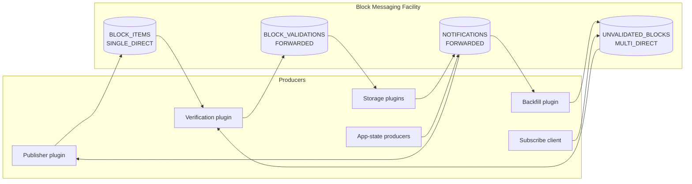
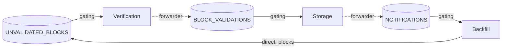
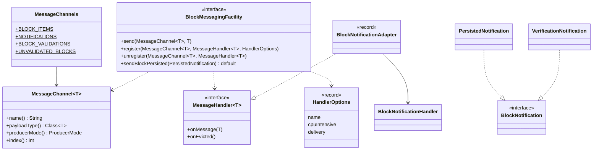
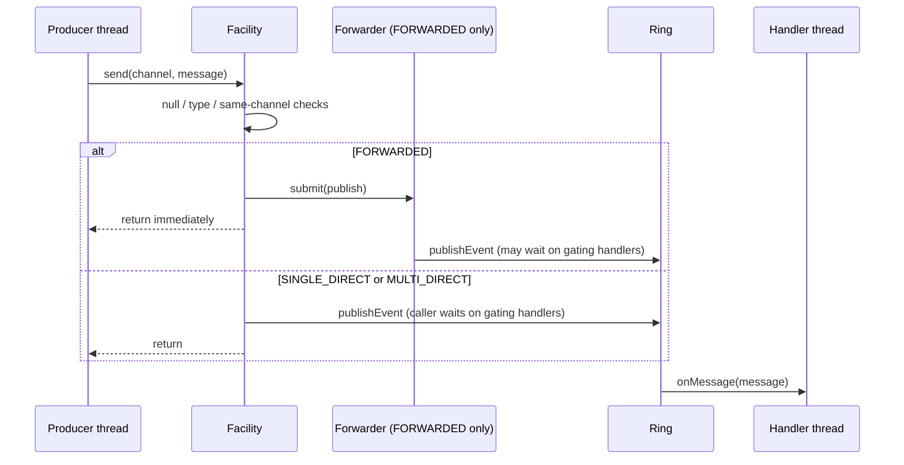
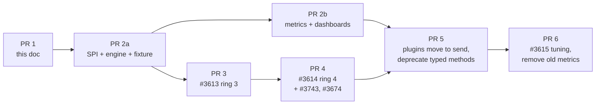

# Block Messaging Channels Design Document

**Status:** Proposed

## Table of Contents

1. [Purpose](#purpose)
2. [Goals](#goals)
3. [Non-Goals](#non-goals)
4. [Terms](#terms)
5. [Current Design](#current-design)
6. [Entities](#entities)
7. [Design](#design)
8. [Diagrams](#diagrams)
9. [Configuration](#configuration)
10. [Metrics](#metrics)
11. [Exceptions](#exceptions)
12. [Migration Plan](#migration-plan)
13. [Acceptance Tests](#acceptance-tests)
14. [Alternatives Considered](#alternatives-considered)
15. [Open Questions](#open-questions)

## Purpose

The Block Messaging Facility exposes one typed `sendX`/`registerX`/`unregisterX` method per message kind. Today
that is 9 notification `sendX` methods, 4 handler interfaces and 2 rings, and every new message kind adds a
method to the SPI, the facility, the test fixture, a counter and a dashboard panel.

Epic [#3612](https://github.com/hiero-ledger/hiero-block-node/issues/3612) adds two more rings,
[#3613](https://github.com/hiero-ledger/hiero-block-node/issues/3613) (Block Validations) and
[#3614](https://github.com/hiero-ledger/hiero-block-node/issues/3614) (Unvalidated Blocks). Both are currently
specified as new typed SPI methods, and #3614 asks that "future producers" can be added without changing the
facility.

This document proposes one generic, typed **channel** API that covers all four rings. The current typed methods
remain as thin `default` methods over it, so plugins can migrate at their own pace.

It supersedes the notifications-only approach in
[#3131](https://github.com/hiero-ledger/hiero-block-node/pull/3131) and addresses the original request in
[#1431](https://github.com/hiero-ledger/hiero-block-node/issues/1431).

## Goals

1. One `send` / `register` / `unregister` API for every ring, keyed by a typed `MessageChannel<T>`.
2. Adding a message kind to an existing channel needs no SPI or facility change.
3. Adding a ring is one constant in `MessageChannels` plus one config key, not a new set of SPI methods.
4. Producer threading (direct vs forwarded) and consumer delivery (gating, best effort, evict on lag) are explicit
   per channel and per handler instead of implied by which method is called.
5. Zero plugin churn in the first implementation PR: all existing typed methods and handler interfaces keep
   working.
6. Uniform, channel-labelled metrics.

## Non-Goals

1. Plugin-defined channels. The channel set is fixed by the SPI (see [Alternatives](#alternatives-considered)).
2. Choosing ring sizes and back-pressure tuning. That belongs to
   [#3615](https://github.com/hiero-ledger/hiero-block-node/issues/3615).
3. Changing any payload record shape, except adding the `BlockNotification` marker.

## Terms

<dl>
  <dt>Channel</dt>
  <dd>A typed, named message stream backed by one Disruptor ring. Identified by a <code>MessageChannel&lt;T&gt;</code>
      constant.</dd>
  <dt>Producer mode</dt>
  <dd>How a <code>send</code> reaches the ring: published on the caller thread (direct) or handed to a per-channel
      forwarder thread (forwarded).</dd>
  <dt>Delivery</dt>
  <dd>How a handler relates to the ring head: <code>GATING</code> (producer waits for it),
      <code>BEST_EFFORT</code> (never waits, never evicted) or <code>EVICT_ON_LAG</code> (never waits, removed when
      too far behind).</dd>
  <dt>Gating handler</dt>
  <dd>A handler whose sequence is added to the ring's gating sequences, so a full ring applies back-pressure to the
      producer.</dd>
  <dt>Forwarder</dt>
  <dd>Single-thread executor that publishes on behalf of the caller so the caller never blocks on a full ring.</dd>
</dl>

## Current Design

Facts below refer to `origin/main` at `e9354734a`.

### Rings and producers

|        Ring         |                 Payload                 | Disruptor producer |                    How `send` publishes                    |       Size config (default)       |
|---------------------|-----------------------------------------|--------------------|------------------------------------------------------------|-----------------------------------|
| Block items         | `BlockItems`                            | `SINGLE`           | Directly on the caller thread; one producer by convention  | `blockItemQueueSize` (512)        |
| Block notifications | 9 records across two handler interfaces | `SINGLE`           | Via `forward(...)` on the single-thread `messageForwarder` | `blockNotificationQueueSize` (32) |

- `BlockMessagingFacilityImpl.sendBlockItems` (L392) publishes with a capturing lambda, so every send allocates.
- Every notification `sendX` (L523–L631) calls `forward(...)` (L508). The forwarder comes from
  `DefaultThreadPoolManager.createSingleThreadExecutor` (L85–L97), a `ThreadPoolExecutor` with an **unbounded**
  `LinkedBlockingQueue`. Forwarding is what lets a gating notification handler send a notification without
  deadlocking on its own ring.
- `VerificationServicePlugin` is a gating consumer **and** a producer on the notification ring.

### Handlers

- `GatingHandler.isGating()` selects back-pressure behaviour. `BlockItemHandler` and `BlockNotificationHandler`
  gate. `NoBackPressureBlockItemHandler` and `ApplicationStateNotificationHandler` do not.
- No-back-pressure block item handlers are evicted at a hard-coded 80% behind head (L456), then
  `onTooFarBehindError()` is called.
- Non-gating application-state handlers are never evicted. A producer can lap them and they silently read
  overwritten slots.
- `BackfillPlugin` and `VerificationServicePlugin` implement both `BlockNotificationHandler` and
  `ApplicationStateNotificationHandler` (verification also implements `BlockItemHandler`), so the two interfaces cannot both extend a new generic handler with a
  `default` method (diamond).

### Known defect

Processors are built with `BatchEventProcessorBuilder` (L882) and never get an exception handler.
`setDefaultExceptionHandler` (L281–L282) only applies to handlers added through the Disruptor DSL. In Disruptor
4.0.0 the fallback is `FatalExceptionHandler`, which rethrows, so a throwing handler kills its processor thread. If
the handler was gating, the ring stalls. Tracked in
[#3882](https://github.com/hiero-ledger/hiero-block-node/issues/3882) and fixed separately from this design.

### Cost of a new message kind today

A new notification touches `BlockMessagingFacility`, `BlockMessagingFacilityImpl` (send, counter, dispatch switch),
`TestBlockMessagingFacility`, a handler interface, metrics docs and dashboards. #3131 tried to remove that cost for
notifications only. Since then main grew from 5 to 9 typed `sendX` methods and gained a second handler interface.

## Entities

All new types live in `org.hiero.block.node.spi.blockmessaging`.

### `MessageChannel<T>`

Final class with a package-private constructor, so only `MessageChannels` can create instances. Identity equality.

|     Field      |      Type      |                       Purpose                        |
|----------------|----------------|------------------------------------------------------|
| `name`         | `String`       | Metric label, thread-name prefix, log context        |
| `payloadType`  | `Class<T>`     | `send` checks `payloadType.isInstance(message)`      |
| `producerMode` | `ProducerMode` | How `send` reaches the ring                          |
| `index`        | `int`          | Dense index; the facility keeps runtimes in an array |

### `MessageChannels`

The fixed set of channels:

|       Constant       |         Name         |       Payload       |  Producer mode  |                    Ring                    |
|----------------------|----------------------|---------------------|-----------------|--------------------------------------------|
| `BLOCK_ITEMS`        | `block-items`        | `BlockItems`        | `SINGLE_DIRECT` | Existing ring 1                            |
| `NOTIFICATIONS`      | `notifications`      | `BlockNotification` | `FORWARDED`     | Existing ring 2                            |
| `BLOCK_VALIDATIONS`  | `block-validations`  | `VerifiedBlock`     | `FORWARDED`     | New ring 3, #3613 ([OQ1](#open-questions)) |
| `UNVALIDATED_BLOCKS` | `unvalidated-blocks` | `UnverifiedBlock`   | `MULTI_DIRECT`  | New ring 4, #3614 ([OQ4](#open-questions)) |

`MessageChannels.ALL` lists them in index order.

### `ProducerMode`

|      Value      |                                 Behaviour                                  | Disruptor `ProducerType` |
|-----------------|----------------------------------------------------------------------------|--------------------------|
| `SINGLE_DIRECT` | Caller publishes, blocks on back-pressure. Only one sending thread allowed | `SINGLE`                 |
| `FORWARDED`     | Per-channel single-thread forwarder publishes. Caller never blocks         | `SINGLE`                 |
| `MULTI_DIRECT`  | Any thread publishes, blocks on back-pressure                              | `MULTI`                  |

### `BlockNotification`

Non-sealed marker interface. All 9 notification records implement it. Non-sealed keeps the door open for
[#1431](https://github.com/hiero-ledger/hiero-block-node/issues/1431) plugin-defined notifications
([OQ5](#open-questions)).

### `MessageHandler<T>`

```java
@FunctionalInterface
public interface MessageHandler<T> {
    /** Called on the handler's own thread, in ring order. Never called with null. */
    void onMessage(T message);

    /** Called once, after unregistering, when an EVICT_ON_LAG handler fell too far behind. */
    default void onEvicted() {}
}
```

### `Delivery` and `HandlerOptions`

```java
public enum Delivery { GATING, BEST_EFFORT, EVICT_ON_LAG }

public record HandlerOptions(String name, boolean cpuIntensive, Delivery delivery) {
    public static HandlerOptions gating(String name) { ... }
    public HandlerOptions withCpuIntensive(boolean cpuIntensive) { ... }
    public HandlerOptions withDelivery(Delivery delivery) { ... }
}
```

### Payloads for the new rings

```java
public record VerifiedBlock(long blockNumber, Bytes hash, BlockUnparsed block, BlockSource source) {}

public record UnverifiedBlock(long blockNumber, BlockUnparsed block, BlockSource source) {}
```

## Design

### Facility API

```java
public interface BlockMessagingFacility extends BlockNodePlugin {
    <T> void send(MessageChannel<T> channel, T message);

    <T> void register(MessageChannel<T> channel, MessageHandler<? super T> handler, HandlerOptions options);

    <T> void unregister(MessageChannel<T> channel, MessageHandler<? super T> handler);

    // Existing typed methods become default methods, for example:
    default void sendBlockPersisted(final PersistedNotification notification) {
        send(MessageChannels.NOTIFICATIONS, notification);
    }

    default void registerBlockNotificationHandler(
            final BlockNotificationHandler handler, final boolean cpuIntensiveHandler, final String handlerName) {
        register(
                MessageChannels.NOTIFICATIONS,
                BlockNotificationHandler.adapt(handler),
                HandlerOptions.gating(handlerName).withCpuIntensive(cpuIntensiveHandler));
    }

    default void unregisterBlockNotificationHandler(final BlockNotificationHandler handler) {
        unregister(MessageChannels.NOTIFICATIONS, BlockNotificationHandler.adapt(handler));
    }
}
```

`send` rules, all checked on the caller thread before anything is queued:

1. `null` channel or message: `NullPointerException`. This removes the `case null` concern raised on #3131, since
   a handler can never see `null`.
2. Message not an instance of `channel.payloadType()`: `IllegalArgumentException`.
3. Direct-mode channel (`SINGLE_DIRECT`, `MULTI_DIRECT`) sent from a thread that is running a `GATING` handler of
   the **same** channel: `IllegalStateException`. That send would deadlock once the ring is full. A `ThreadLocal`
   set by the processor wrapper implements the check.

`register` and `unregister` are `synchronized`, as today. Handlers registered before `start()` are queued and
attached on start, matching current behaviour.

### Legacy adapters

Only two classes implement `BlockMessagingFacility`: `BlockMessagingFacilityImpl` and
`TestBlockMessagingFacility`. So turning the typed methods into `default` methods needs no plugin change.

The old handler interfaces stay as convenience APIs. Each gets a static `adapt(handler)` factory returning a
package-private adapter record:

|             Old interface             |                Adapter                |     Channel     |    Delivery    |
|---------------------------------------|---------------------------------------|-----------------|----------------|
| `BlockItemHandler`                    | `BlockItemAdapter`                    | `BLOCK_ITEMS`   | `GATING`       |
| `NoBackPressureBlockItemHandler`      | `NoBackPressureBlockItemAdapter`      | `BLOCK_ITEMS`   | `EVICT_ON_LAG` |
| `BlockNotificationHandler`            | `BlockNotificationAdapter`            | `NOTIFICATIONS` | `GATING`       |
| `ApplicationStateNotificationHandler` | `ApplicationStateNotificationAdapter` | `NOTIFICATIONS` | `BEST_EFFORT`  |

```java
record BlockNotificationAdapter(BlockNotificationHandler delegate) implements MessageHandler<BlockNotification> {
    @Override
    public void onMessage(final BlockNotification notification) {
        switch (notification) {
            case VerificationNotification v -> delegate.handleVerification(v);
            case PersistedNotification p -> delegate.handlePersisted(p);
            case BackfilledBlockNotification b -> delegate.handleBackfilled(b);
            case NewestBlockKnownToNetworkNotification n -> delegate.handleNewestBlockKnownToNetwork(n);
            case PublisherStatusUpdateNotification s -> delegate.handlePublisherStatusUpdate(s);
            default -> {}
        }
    }
}
```

Two properties make this work:

- **Record equality.** `adapt(h).equals(adapt(h))`, so the default `unregisterX(h)` can build a fresh adapter and
  the facility finds the registered one. No adapter cache is needed.
- **Static factories, not default methods.** `BackfillPlugin` implements both notification interfaces, so a
  `default` bridge method on each would clash. Static methods do not.

`NoBackPressureBlockItemAdapter.onEvicted()` calls `onTooFarBehindError()`.
`GatingHandler.isGating()` is deprecated, because delivery now comes from `HandlerOptions`. The interfaces and
their `handleX` methods are not deprecated: tests call `handleX(` directly over 250 times.

### Block items

`BLOCK_ITEMS` becomes a normal channel with `SINGLE_DIRECT`. `EVICT_ON_LAG` delivery replaces the special
no-back-pressure registration path, and the eviction threshold becomes configurable
(`nonGatingEvictionPercent`, default 80, same as today). `sendBlockItems` and `registerBlockItemHandler` stay as
entry points and are **not** deprecated ([OQ3](#open-questions)).

### Engine

One `ChannelRuntime<T>` per channel, held in an array indexed by `MessageChannel.index()`:

- the `Disruptor<MessageRingEvent<T>>` sized from config,
- the forwarder (only for `FORWARDED`), created with the thread-pool manager as today, named
  `messageForwarder-<channel>`,
- handler → processor and handler → thread maps,
- metric handles.

`MessageRingEvent<T>` is a single mutable holder (`set(T)` / `get()`), replacing `BlockItemBatchRingEvent` and
`BlockNotificationRingEvent`. Publishing uses one static `EventTranslatorOneArg`, so a direct send does not allocate a
lambda. A forwarded send still allocates the submitted task and its queue node. Each processor wraps the handler to compute percentage behind head (as today), apply `EVICT_ON_LAG`,
set the same-channel `ThreadLocal`, catch and count exceptions, and log them.

Every processor keeps the explicit exception handler added by the [#3882](https://github.com/hiero-ledger/hiero-block-node/issues/3882)
fix and counts in `messaging_handler_errors` ([OQ11](#open-questions)).

Memory held by a ring is `queueSize × largest payload`. Rings 3 and 4 carry whole blocks, so their sizes must
be small. The numbers are left to #3615.

A `FORWARDED` channel has no ceiling: its forwarder queue is unbounded, so when gating consumers fall behind,
back-pressure becomes heap growth instead of a blocked producer. For `BLOCK_VALIDATIONS` that backlog is whole
blocks. This is the price of the loop safety described below ([OQ1](#open-questions)).

### Ordering and loops

Within a channel, all handlers see messages in publish order. There is no ordering between channels.

With ring 4 the data flow becomes a loop:

`UNVALIDATED_BLOCKS` → verification → `BLOCK_VALIDATIONS` → storage → `NOTIFICATIONS` (persisted) → backfill →
`UNVALIDATED_BLOCKS`.

A loop of gating handlers that all publish directly can deadlock once every ring is full. Any channel a gating
handler on the loop publishes to must break the cycle. Here `BLOCK_VALIDATIONS` and `NOTIFICATIONS` are
`FORWARDED`, and the same-channel `ISE` catches the simple case. The forwarder queues are unbounded today, so the
`messaging_forwarder_pending` gauge is how operators see a stuck consumer behind a forwarder.

Rule for producers on the loop: a gating handler never publishes to another channel from its own thread. It hands
the message to the plugin's own worker, so a full downstream ring blocks that worker instead of the upstream ring's
gating sequence. With this rule, the loop no longer depends on unbounded forwarders for liveness.

### Test fixture

`TestBlockMessagingFacility` implements the three generic methods. The typed getters
(`getSentPersistedNotifications()` etc., about 230 calls in 16 files) remain and return **live** per-type lists,
because nine call sites in two test classes `.clear()` them. A generic `getSent(channel)` is added for new tests.

## Diagrams

### Channel topology



### Ring loop and where forwarding breaks it



### SPI classes



### Send sequence



### Migration timeline



## Configuration

`MessagingConfig` keeps flat keys (prefix `messaging`):

|             Key              | Default |            Added by            |
|------------------------------|---------|--------------------------------|
| `blockItemQueueSize`         | 512     | existing                       |
| `blockNotificationQueueSize` | 32      | existing                       |
| `nonGatingEvictionPercent`   | 80      | PR 2a (replaces hard-coded 80) |
| `blockValidationQueueSize`   | TBD     | #3613, default chosen in #3615 |
| `unvalidatedBlockQueueSize`  | TBD     | #3614, default chosen in #3615 |

Queue sizes must stay positive powers of two.

## Metrics

New metrics, all with a `channel` label:

|              Name              |  Type   |  Extra labels  |                 Meaning                  |
|--------------------------------|---------|----------------|------------------------------------------|
| `messaging_messages_sent`      | Counter | `message_type` | Messages accepted by `send`              |
| `messaging_queue_percent_used` | Gauge   |                | Ring fill relative to the slowest gater  |
| `messaging_handlers`           | Gauge   | `delivery`     | Registered handlers                      |
| `messaging_handler_evictions`  | Counter |                | `EVICT_ON_LAG` evictions                 |
| `messaging_handler_errors`     | Counter |                | Exceptions thrown by handlers            |
| `messaging_forwarder_pending`  | Gauge   |                | Tasks waiting in the channel's forwarder |

`message_type` is the payload's simple class name, for example `PersistedNotification`.
hiero-metrics supports labelled observable gauges (`ObservableGauge.observe(supplier, labelNamesAndValues...)`).

The existing 10 counters (`messaging_block_items_received` and 9 `messaging_*_notifications`) and 4 gauges
(`messaging_no_of_item_listeners`, `messaging_no_of_notification_listeners`,
`messaging_item_queue_percent_used`, `messaging_notification_queue_percent_used`) are emitted alongside the new
ones for one minor release so dashboards and alerts can move, then removed in #3615.
`messaging_block_items_received` counts items, not batches; its replacement is
`messaging_messages_sent{channel="block-items"}` plus a `messaging_block_items_sent` counter.

## Exceptions

|               Where               |           Exception            |                         Meaning                          |
|-----------------------------------|--------------------------------|----------------------------------------------------------|
| `send`                            | `NullPointerException`         | Null channel or message                                  |
| `send`                            | `IllegalArgumentException`     | Message is not the channel's payload type                |
| `send`                            | `IllegalStateException`        | Direct send from a gating handler of the same channel    |
| `send` after `stop()` (forwarded) | none, dropped and logged DEBUG | Same as today's `forward(...)`                           |
| `send` after `stop()` (direct)    | `IllegalStateException`        | Ring is halted; publishing would block forever once full |
| Handler `onMessage`               | caught, logged, counted        | Processor keeps running; no ring stall                   |

## Migration Plan

| PR |                             Scope                             |                       Plugin changes                       |
|----|---------------------------------------------------------------|------------------------------------------------------------|
| 1  | This design doc                                               | none                                                       |
| 2a | SPI types, channel engine, adapters, fixture                  | none; existing facility and plugin tests prove equivalence |
| 2b | New metrics (dual-emitted), dashboard updates                 | none                                                       |
| 3  | #3613 on `BLOCK_VALIDATIONS`                                  | verification producer, storage consumers                   |
| 4  | #3614 on `UNVALIDATED_BLOCKS`, with #3743 and #3674           | backfill, subscribe client, verification                   |
| 5  | Plugins move to `send` / `register`; typed methods deprecated | all plugins, one or a few per PR                           |
| 6  | #3615 sizing and tuning; old metrics removed                  | none                                                       |

The architecture documents (`current-plugin-architecture.md`, `new-plugin-architecture.md`, `data-flow.md` and
plugin designs naming typed methods) are updated in PR 5, once the typed API is deprecated.

## Acceptance Tests

1. All existing `facility-messaging` tests pass unchanged against the channel engine (PR 2a).
2. All plugin tests pass unchanged with the rebuilt `TestBlockMessagingFacility` (PR 2a).
3. `send` with `null` throws `NullPointerException` on the caller thread and nothing reaches the ring.
4. `send` with a wrong payload type throws `IllegalArgumentException`.
5. A direct send from a gating handler of the same channel throws `IllegalStateException`.
6. A handler that throws on one message still receives the next message, and a gating producer is not stalled.
7. An `EVICT_ON_LAG` handler past `nonGatingEvictionPercent` is unregistered and `onEvicted()` fires exactly once.
8. A `BEST_EFFORT` handler never blocks the producer.
9. `unregisterX(h)` after `registerX(h)` removes the handler (adapter record equality).
10. A handler implementing both notification interfaces receives each message kind exactly once.
11. A forwarded send returns while the ring is full and is delivered once a gating handler catches up.
12. `messaging_messages_sent{channel,message_type}` matches the old per-type counters during dual emission.
13. A direct send does not allocate per send (JMH or allocation profiling, PR 2a).
14. A direct send after `stop()` throws `IllegalStateException`; a forwarded send after `stop()` is dropped.

## Alternatives Considered

1. **Typed SPI methods per ring** (current #3613/#3614 wording): repeats the per-type bookkeeping for each ring.
2. **#3131, generic notifications only**: fixes ring 2 but leaves rings 1, 3 and 4 with separate APIs.
3. **Plugin-defined channels**: rings are memory-heavy and need operator sizing, so a fixed set is safer.
4. **One ring with routing by type**: block-sized and small payloads would share one ring and one back-pressure.
5. **Sealed `BlockNotification`**: exhaustive switches, but rules out #1431 plugin-defined notifications.
6. **Subscription handle returned by `register`**: cleaner unregister, but every existing caller would change;
   adapter record equality gives stateless unregister without that churn.

## Open Questions

1. **Ring 3 producer mode.** `FORWARDED` (never blocks verification, breaks the loop, but a slow storage consumer
   grows an unbounded queue of whole blocks) or `SINGLE_DIRECT` (bounded memory, back-pressure reaches
   verification, but loop safety must then be proven elsewhere)? A bounded forwarder is a third option.
2. **`BEST_EFFORT` overtaking.** App-state handlers can be lapped today and read overwritten slots. Should
   `BEST_EFFORT` handlers also be evicted, or should a lapped handler skip to head and log?
3. **Public `send` on `BLOCK_ITEMS`.** Allow it, or keep block items reachable only through `sendBlockItems` because
   of the single-producer rule?
4. **Ring 4 payload.** Full `UnverifiedBlock`, or the #3674 `oneof` shape?
5. **Plugin-defined notifications** (#1431): which JPMS rules let a third-party record implement
   `BlockNotification` and reach handlers in other modules?
6. **`VerificationNotification.block`.** Once ring 3 carries `VerifiedBlock`, when is the `block` field removed
   from the notification?
7. **Eviction threshold** per channel or global (`nonGatingEvictionPercent`)?
8. **Forwarder per channel.** Epic #3612 lists the `messageForwarder` as out of scope. Is one forwarder per
   `FORWARDED` channel acceptable, or should all forwarded channels share one?
9. **Deprecation window** for the typed methods and old metrics: one minor release or longer?
10. **`BlockSource` naming.** #3674 proposes `SUBSCRIBER`; is `SUBSCRIBED` more consistent with `PUBLISHER` /
    `BACKFILL` / `HISTORY`? Note `BlockSource` is a Java enum, not a proto.
11. **Gating handler failures.** Log, count and continue keeps the ring moving, but a gating storage handler that
    throws then skips that block silently, where today the ring stalls. Should gating handlers instead stop the
    node (or unregister and raise a health signal)?
