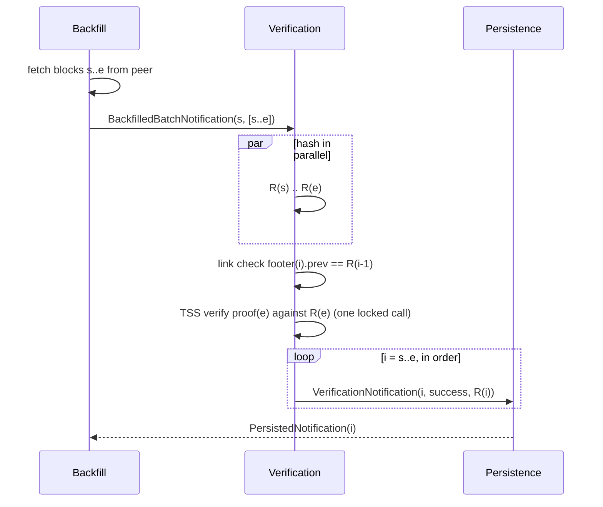

# Chain-Anchored Batch Verification for Backfill

Status: **deferred**, low priority, tracked by #3859. This is a future improvement, not needed
now; see [Assessment](#assessment-is-it-still-worth-it). It is still open for review, for
example alongside the parallel verification work.
Baseline: `main` at `e9354734a`, which includes #3853 and hedera-cryptography 3.22.0.

## Purpose

Backfill verifies every block with its own TSS check. `NativeVerificationLibrary` runs every
`TSS.verifyTSS` call under one process-wide lock, so the TSS cost per block sets the ceiling
of backfill verification.

On hedera-cryptography 3.21.0 one call took about 120 ms (hiero-ledger/hiero-cryptography#753),
which capped a node at about 8 blocks/s; observed backfill ran at 6 to 7 blocks/s. 3.22.0
(hiero-ledger/hiero-cryptography#755) caches the WRAPS proof result, about 85% of that cost.
On `main` today a call takes about 13 ms, about 78 blocks/s. See
[Library 3.22.0: WRAPS proof cache](#library-3220-wraps-proof-cache).

This proposal verifies a contiguous batch of backfilled blocks with **one** signature check
plus a hash chain check, instead of one signature check per block.

## Assessment: is it still worth it?

**Not now. Keep it as a future improvement.** The reasons, measured in
[Expected Throughput](#expected-throughput):

1. **The library fix removed most of the gap.** 3.22.0 makes per-block TSS about 9 times
   faster (about 8 to about 78 blocks/s). A day of TSS blocks (about 43,200) now verifies in
   about 9 minutes, instead of about 1.5 h. Live production is one block every 2 s, so a node
   catches up at about 150 times real time.
2. **Historical mainnet backfill is not TSS bound.** Blocks from before the TSS era are wrapped
   record blocks (WRBs), verified with RSA in plain Java, without the lock. The estimate is
   about 4,500 to 7,000 blocks/s on 10 cores, so the roughly 100 million historical blocks are
   bounded by fetch and persistence, not by TSS. Batching TSS would not change that.
3. **What batching still buys.** Batches of 100 verify about 5,000 blocks/s versus 78 per
   block, about 64 times faster. That only matters once the **TSS era** itself is long:

   |    TSS-era history     | Per block  | Batch of 100 |
   |------------------------|------------|--------------|
   | 1 month (~1.3M blocks) | ~4.6 h     | ~4 min       |
   | 1 year (~15.8M blocks) | ~2.3 days  | ~53 min      |
   | 5 years (~79M blocks)  | ~11.7 days | ~4.4 h       |

4. **The cost of batching has not changed.** It needs an SPI change, a new session type and
   batch-scoped backfill awaiting. It also accepts the
   [proof gap](#proofs-of-intermediate-blocks-decision-shape-check) for intermediate blocks.
   With per-block verification at about 78 blocks/s, that complexity and that gap are hard to
   justify today.

**When to revisit:**
- the TSS era passes roughly 6 to 12 months, so a new Tier 1 node would take days to backfill
it per block; or
- per-block TSS becomes the measured bottleneck of backfill, ahead of fetch and persistence
(watch `verification_tss_lock_wait_time`, see [Metrics](#metrics)); or
- WRAPS proofs start changing often enough that the 3.22.0 cache misses (about 120 ms each).

**Cheaper step first:** relax the lock. Since 3.22.0 the library does not need serialized
calls; `NativeVerificationLibrary` keeps the lock only to narrow a start-up ordering gap, when a
node has no verified block yet. Holding the lock only for that window would let the about 13 ms
hinTS check run on all cores, with none of batching's trade-offs. How well the hinTS check
scales across cores has not been measured yet.

## Goals

1. Use one TSS verification for each contiguous batch of backfilled blocks. Today it is one
   per block.
2. Keep the security level at the current per-block verification level. The batch check
   relies only on SHA-256 second preimage resistance, which the TSS signature already depends on.
3. Keep the downstream contract unchanged: one `VerificationNotification` per block, in
   order, with the same `source` and `blockHash`.
4. Keep the worst case no slower than today. Any batch failure falls back to per-block cost.
5. Leave the live publisher path unchanged.

## Terms

- **`R(i)`:** the block root hash of block `i`, computed by `BlockHasher`.
- **Batch `[s .. e]`:** contiguous blocks `s` to `e`, sent to verification together.
- **Link:** `footer(i).previousBlockRootHash == R(i-1)`. A **link break** at `i` means it does
  not hold.
- **Segment:** a run of linked blocks inside a batch with one proof key. A batch has one
  segment unless it contains a link break or a key change.
- **Anchor:** the last block of a segment. Its proof is the only one fully verified.
- **WRB:** wrapped record block, a pre-TSS block carrying a `SignedRecordFileProof`.

## Why It Is Sound

The block root hash commits to the previous block. In `HashingUtilities.computeFinalBlockHash`,
`previousBlockRootHash` is the first leaf (position 0) of the 16-leaf tree that, together with
the block timestamp, forms the root.

For a batch `[s .. e]`:

1. Hash every block and compute `R(s) .. R(e)`.
2. **Link check.** For each `i` in `s+1 .. e`, require `footer(i).previousBlockRootHash == R(i-1)`.
3. **Anchor check.** Verify the proof of block `e` (TSS, or a state proof) against `R(e)`.

If step 3 passes, the network signed `R(e)`. `R(e)` commits to `footer(e).previousBlockRootHash`,
and step 2 shows that value equals `R(e-1)`. So `R(e-1)` is the hash the network chained from.
Applied inductively down to `s`, every block in the batch is authenticated. To forge block `k`,
an attacker must find a second preimage for `R(k)` under SHA-256.

The anchor must be the **last** block of the batch. The chain points backward, so a verified
first block says nothing about the blocks after it.

## Current State (facts from the code)

- **No cross-block hash check today, and none is needed per block.** `previousBlockRootHash`
  is only size checked and hashed into the root (`BlockHasher.finalHashingResult` :414-477).
  Each block carries its own signature over a root that already commits to its predecessor, so
  per-block verification does not need the previous block. That is why sessions can verify out
  of order, which is common during backfill. The link check in this design is needed only
  inside a batch, because the intermediate blocks have no verified signature of their own.
- **Block proofs are not covered by the root hash.** `BLOCK_PROOF` items are collected and
  never hashed (`BlockHasher.processItem`).
- **Backfill is batched only at fetch time.** `BackfillRunner` fetches `fetchBatchSize`
  (default 10, max 1,024) blocks. It then sends one `BackfilledBlockNotification` per block,
  awaits persistence per block (`perBlockProcessingTimeout` 1,000 ms), and sleeps
  `delayBetweenBatches` (1,000 ms) before the next chunk. Block 0 is always fetched alone.
- **Hashing runs in parallel, TSS does not.** Each block has its own `CompletableVerificationSession`
  on a virtual-thread executor. All `verifyTss` calls go through the fair
  `NativeVerificationLibrary.LOCK`. The library does not need it since 3.22.0; it is kept to
  narrow a start-up ordering gap.
- **`StateProofVerifier`** already does "one signature covers another root". It only proves the
  current block's own root, inside that block's session.

## Entities

- **`BackfilledBatchNotification`** (new, SPI): `(long startBlockNumber, List<BlockUnparsed> blocks)`.
- **`BatchVerificationSession`** (new, verification plugin): hashes, links, segments and
  anchors one batch.
- **Reused unchanged:** `BlockHasher`, `BlockVerifier` (TSS, state proof and RSA) and
  `ResultOrderingManager`.

## Design

### Option A (recommended): explicit batch notification

The batch boundary is chosen by backfill, which already holds the batch, and is passed to
verification explicitly.

1. **SPI.** Backfill sends one `BackfilledBatchNotification` per chunk instead of N. The blocks
   must be contiguous. The single-block `BackfilledBlockNotification` stays for block 0, retries,
   and single-block gaps.
2. **Verification plugin.** A `BatchVerificationSession` runs these stages:
   - **Hash.** Hash every block in parallel with the existing `BlockHasher`, giving a
     `HashingResult` per block. Each block's header number must equal `startBlockNumber + i`;
     a mismatch fails that block. Otherwise a peer could serve a valid chain under shifted
     numbers, and the anchor proof would still verify.
   - **Link.** Check the footers from `s+1` to `e`. Block `s` is not linked to `s-1`: batches
     are independent, can verify out of order, and do not depend on each other.
   - **Segment.** A link break at `k` splits the batch into `[s .. k-1]` and `[k .. e]`. So does
     a proof key change (see [Proofs of intermediate blocks](#proofs-of-intermediate-blocks-decision-shape-check)).
     Each segment is anchored on its own last block, so it costs one TSS check per segment.
   - **Anchor.** Run the existing `BlockVerifier` on the last block of each segment. TSS,
     state proof and RSA all work unchanged.
   - **Emit.** Send one success `VerificationNotification` per block through
     `ResultOrderingManager`, in order. Downstream sees exactly what it sees today.
3. **Anchor failure.** Report the anchor block as `BAD_BLOCK_PROOF`. Re-anchor the rest of the
   segment on its previous block, or simply fall back to per-block sessions. The worst case is
   then today's cost. No block in a segment is reported verified until an anchor of that segment
   verifies.
4. **Backfill.** Await persistence with a batch-scoped deadline, not a per-block timeout:
   the first block completes only when the whole batch is verified. Raise the effective
   `fetchBatchSize` (for example 100). Revisit `delayBetweenBatches`, which caps throughput
   at about B blocks per second on its own, whatever the verify cost.

### Option B: deferred anchoring inside per-block sessions

Keep the per-block notifications. A backfill session whose root hash equals the
`previousBlockRootHash` of a verified block `N+1` is marked verified. Sessions park until
an anchor arrives. This needs no SPI change. It does need lookahead state, anchor timeouts
and interaction with session eviction (`activeSessionsBufferSize`). It is harder to reason
about, and is not recommended.

### Proofs of intermediate blocks (decision: shape check)

Because proofs are outside the root hash, a batch-verified intermediate block's
`BLOCK_PROOF` bytes are **not authenticated**. A malicious peer could keep the block contents
and swap in garbage proofs. The node would then persist and serve blocks whose own proofs
fail for downstream consumers that verify per block (Mirror Node, other BNs,
`BlockContentProof`).

**Decision:** every intermediate proof gets a cheap shape check:
- it must be a recognised proof type (`signed_block_proof`, `block_state_proof` or
`signed_record_file_proof`);
- a TSS signature must have the layout the library defines (13,712 B today). The Block Node
treats signatures as opaque, so this layout must come from the library, not be hard-coded.

The check then compares the proof with the anchor's:
- **Same type and, for TSS, same hinTS verification key** (the signature prefix): the block
stays in the segment.
- **Different type or key:** this is not a failure. The hinTS key changes with every roster
change, so an honest batch can span one. The block ends a segment, and the earlier part is
anchored on its own last block.
- **Malformed proof:** the block fails with `BAD_BLOCK_PROOF`, and the batch splits around it.

This catches malformed or substituted proofs from a broken peer. It does not catch a
well-formed proof with forged signature bytes. That gap is accepted, and will be documented in
`docs/design/block-verification.md` when this design is implemented.

The impact of the gap is bounded:
- The block's **contents** are still authenticated through the chain. A forged proof cannot
make any consumer accept bad data.
- The worst case is that a correct block fails a downstream per-block proof check. That is a
visible failure, not silent corruption.
- It requires a malicious peer to serve the batch.

#### How this differs from state proofs

Batch verification and `block_state_proof` share the same trust model: a signature on a later
root authenticates an earlier block's contents through hashes. They differ in what the node
stores:

|                      |                                          State proof                                           |                 Batch, intermediate block                 |
|----------------------|------------------------------------------------------------------------------------------------|-----------------------------------------------------------|
| Proof in the block   | The state proof itself: Merkle paths up to a later signed root, plus that root's TSS signature | The block's own TSS signature                             |
| Verified by the node | Fully, by `StateProofVerifier`                                                                 | Shape check only                                          |
| Stored proof valid   | Yes, always                                                                                    | Yes for honest peers; not guaranteed for a malicious peer |

The gap is therefore specific to batching. A state proof block carries the very proof that
was checked. A batch-verified intermediate block carries a proof that was not checked.

Considered and rejected for now: a background audit that fully verifies intermediate proofs
at low priority. It would spend the same TSS cost that batching saves.

### Constraints

- Batches never include block 0, which is already sent alone for TSS bootstrap.
- The publisher (live) path is not affected: one block per about 2 s does not need batching.
- `allSourcesRequireOrdering=true` (the Tier 1 default) is preserved, because emission is ordered.
- Per-block fallback for a batch of 100 opens 100 sessions, the whole default
  `activeSessionsBufferSize` (100). Fallback must open sessions in bounded steps, or the buffer
  must be sized for it, so live sessions are not evicted.
- Memory: see [Memory bound](#memory-bound).

### Memory bound

A batch holds all of its blocks in memory until its anchor verifies. Backfill already holds a
whole fetched chunk until it is persisted; what changes is the batch size. A block count alone
is not a safe bound, because block size varies widely. For example, 100 blocks of 31.6 MB
(fixture block 322) would hold over 3 GB in memory. A batch is therefore capped by **total
serialized bytes** as well as by block count:

- **Building batches.** Backfill adds blocks in order to a verification batch until either:
  - the next block would push the batch over `backfill.maxBatchBytes`, or
  - the batch reaches `fetchBatchSize` blocks.
- **Large chunks.** A fetched chunk above the cap is split into several verification batches.
  Each one is anchored on its own last block, so it costs one TSS check per batch.
- **Oversized blocks.** A single block larger than the cap becomes a batch of one, verified per
  block as today.
- **Total memory.** Each backfill scheduler (historical and live tail) keeps one batch in flight
  at a time. So batch memory stays at about 2 × `maxBatchBytes`, plus the hashing working set.
- **Fetch side.** The bound sits next to the existing ones: `maxIncomingBufferSize` (100 MiB)
  and `maxProtobufMessageSizeBytes` (about 131 MB per message).
- **Throughput.** With small blocks the byte cap is never hit. With large blocks, hashing
  dominates: a full 256 MiB batch hashes in about 110 ms on 10 cores, against about 13 ms for
  the one TSS call. So smaller batches cost little.

## Diagram

## Expected Throughput

The TSS cost per block becomes `t / B`, where `t` is one `TSS.verifyTSS` call. For example,
B = 100 on 3.22.0+ gives about 0.13 ms per block. Throughput is then bounded by fetch, hashing
and persistence, not by the lock.

### Library 3.22.0: WRAPS proof cache

A TSS signature is `hints_verification_key || hints_signature || compressed_wraps_proof`.
`TSS.verifyTSS` checks two things:
- the WRAPS proof, which ties the hinTS key to the ledger id;
- the hinTS aggregate signature over the block root hash.

The WRAPS proof only changes with the roster. hiero-cryptography#755 caches the WRAPS result in
an LRU of 8 entries, keyed by `(wraps proof, ledger id, hinTS verification key)`. The hinTS
check still runs on every call. The cache is sound because the WRAPS check is deterministic,
its verification key is embedded in the library, and the hinTS key is part of the cache key.

|                Step                 |   p50    |
|-------------------------------------|----------|
| `TSS.verifyTSS`, no cache (3.21.0)  | 119.5 ms |
| WRAPS `verifyCompressedProof` only  | 104.0 ms |
| hinTS `verifyAggregate` only        | 12.8 ms  |
| `TSS.verifyTSS`, cache hit (3.22.0) | 12.9 ms  |

The cached path still rejects a wrong root hash and a tampered hinTS signature. The first call
is a cache miss and takes about 120 to 140 ms; after that it hits until the WRAPS proof changes.

### Measured end to end: per block vs batch

These numbers use the real `BlockHasher` and the real locked `NativeVerificationLibrary.verifyTss`.
The setup:
- branch `tss-update` (#3853), Apple M1 Max, 10 cores, JDK 25.0.2;
- a 14,451 B TSS fixture block;
- real 13,712 B signatures from `TssBlockSigner`;
- a fixed pool of 10 threads, warmed up with 200 hashes, 5,000 blocks per run.

The two modes:
- **Per block:** each task hashes one block and calls `verifyTss`.
- **Batch of 100:** hash 100 blocks in parallel, then one `verifyTss`. Batches run one after
another, with no pipelining, so the figure is conservative.

| Library | `verifyTss` warm p50 | Hash only (10 threads) |    Per block    |    Batch of 100    |
|---------|----------------------|------------------------|-----------------|--------------------|
| 3.21.0  | 122.5 ms             | ~12,900 blocks/s       | **8 blocks/s**  | **762 blocks/s**   |
| 3.22.0  | 13.4 ms              | ~10,900 blocks/s       | **77 blocks/s** | **4,879 blocks/s** |
| 3.23.0  | 12.7 ms              | ~12,600 blocks/s       | **78 blocks/s** | **4,991 blocks/s** |

3.23.0 adds a hinTS CRS and aggregation key cache (hiero-cryptography#752), which makes no
measurable difference here.

### Block size and hashing cost

Hashing is pure SHA-256 in Java and scales with block size. Measured on one thread (median) and
on 10 threads:

|          Block          |  Size   | One thread, median |       10 threads        |
|-------------------------|---------|--------------------|-------------------------|
| WRAPS block 3 (small)   | 14 KB   | 0.67 ms            | see the table above     |
| WRAPS block 322 (large) | 31.6 MB | 37.7 ms (840 MB/s) | ~77 blocks/s (2.4 GB/s) |

A small block hashes about 20 times faster than one cached TSS call. A 31.6 MB block takes
about 3 times longer to hash than to verify. These are test-network fixtures; the MB/s figures
scale to any mainnet block size. Re-measure on mainnet captures before setting a target.

### Historical blocks: RSA, not TSS

WRBs carry a `SignedRecordFileProof`. `RSAProofVerifier` checks it with `SHA384withRSA` in plain
Java, without the lock. It was measured on the real mainnet fixture `V5_BLOCK_26591040`
(2022-01-01, 24,129 B, 12 signatures, 24-node address book):

|      Mode       |                            Result                            |
|-----------------|--------------------------------------------------------------|
| One thread, p50 | 0.99 ms per block (0.082 ms per signature) = ~1,000 blocks/s |
| 10 threads      | ~7,200 blocks/s                                              |

This covers payload reconstruction and RSA only. The fixture predates the move to SHA-256, so
today's `BlockHasher` refuses it, and the probe skipped block hashing. The rate with hashing is
therefore an **extrapolation**: adding the warm hashing rate above (~12,000 blocks/s) gives
about 4,500 blocks/s, and 7,000 is the upper bound if hashing overlaps fully. Re-measure on
SHA-256 WRBs once they exist.

### Mainnet backfill estimate (verification only)

This is for about 100 million blocks, mostly small, on one 10-core node. It covers verification
alone: no fetch, persistence, `delayBetweenBatches` or messaging overhead.

|              Scenario               |           Rate           |  100M blocks  |
|-------------------------------------|--------------------------|---------------|
| All TSS, per block, 3.21.0          | 8 blocks/s               | ~145 days     |
| All TSS, batch of 100, 3.21.0       | 762 blocks/s             | ~36 h         |
| All TSS, per block, 3.22.0+         | 78 blocks/s              | ~15 days      |
| All TSS, batch of 100, 3.22.0+      | ~5,000 blocks/s          | ~5.6 h        |
| Hashing ceiling, 10 threads         | ~12,000 blocks/s         | ~2.3 h        |
| **Realistic: historical WRBs, RSA** | ~4,500 to 7,000 blocks/s | **~4 to 6 h** |

The "all TSS" rows are hypothetical: today's 100 million mainnet blocks are almost all
historical WRBs. They show what a fully TSS-era history of that size would cost.

## Configuration

|                Property                 |         Default          |                       Notes                        |
|-----------------------------------------|--------------------------|----------------------------------------------------|
| `verification.batchVerificationEnabled` | `true`                   | Kill switch, falls back to per-block               |
| `backfill.fetchBatchSize`               | revisit (10 today)       | Directly sets the TSS amortization factor          |
| `backfill.delayBetweenBatches`          | revisit (1,000 ms today) | Currently a throughput cap on its own              |
| `backfill.batchProcessingTimeout`       | new                      | Replaces per-block awaiting for batches            |
| `backfill.maxBatchBytes`                | new, 256 MiB             | Upper bound on the bytes of one verification batch |

## Metrics

- `verification_batch_total{result}`, `verification_batch_size` and `verification_batch_bytes` (histograms)
- `verification_batch_link_breaks_total`
- `verification_batch_segments_total{reason}` (link break, key change, malformed proof)
- `verification_tss_lock_wait_time`, which is missing today, and is useful regardless of this change
- `verification_proof_shape_check_failures_total`

## Exceptions

- Link break or proof key change: split into segments. This is not a failure by itself.
- Anchor `BAD_BLOCK_PROOF`: fail only the anchor, then re-anchor or fall back per block.
- Malformed block inside a batch (parse error, missing footer, wrong block number): fail that
  block, then split the batch around it.

## Acceptance Tests

1. A valid batch of N blocks makes exactly one `verifyTss` call and sends N in-order success notifications.
2. Tampered contents in block `k < e` cause a link break at `k+1`. Block `k` is never reported verified.
3. A tampered anchor signature sends no success for any block in the segment.
4. A garbage proof on an intermediate block (unknown type or wrong layout) fails the shape
   check, and that block is not reported verified.
5. A batch with a link break costs one TSS call per segment.
6. A batch that spans a roster change verifies every block, with one TSS call per side.
7. A block whose header number does not match its position in the batch is not reported verified.
8. Per-block fallback behaves exactly like today when `batchVerificationEnabled=false`.
9. A backfill throughput benchmark shows a clear gain over per-block verification on the same
   library (about 78 blocks/s on 3.22.0+).
10. No verification batch exceeds `maxBatchBytes`. A chunk above the cap is split into several
    batches, and a single block larger than the cap is verified per block.

## Concerns Raised in Review

**"Trusting blocks based on a later proof makes it too easy to sneak in a flawed block."**
It does not. Changing any byte of a block inside the batch changes its root hash. Then the next
block's `previousBlockRootHash` no longer matches, and the block is rejected. Forging a block
requires a SHA-256 second preimage. Every TSS check already relies on that assumption, since
TSS signs only a 32-byte hash. The protocol already accepts this trust model for
`block_state_proof`.

**"…or a proof-free block."**
Every block must still carry a proof, or it fails `MISSING_MANDATORY_ITEM` as today. Every
intermediate proof gets a shape check. The remaining gap, a well-formed proof with forged
signature bytes, is described in
[Proofs of intermediate blocks](#proofs-of-intermediate-blocks-decision-shape-check).

**"We need to verify every block proof for every block."**
Per-block proof verification gives no extra assurance about a block's contents beyond the
chain. Its only additional guarantee is that the stored proof bytes are valid. Recovering that
guarantee costs the per-block TSS check that this design removes.

**"Verification is already parallel, one thread per block."**
Hashing is parallel. TSS is not: every call takes the process-wide lock, which sets the ceiling
of about 78 blocks/s. Relaxing the lock is the
[cheaper step](#assessment-is-it-still-worth-it), and it combines with batching.

**"Holding a whole batch in memory until the last block verifies is a risk."**
Backfill already holds each fetched chunk until it is persisted. Batches are capped by total
bytes as well as by block count; see [Memory bound](#memory-bound).

**"Bulk load from a trusted, signed package is the fastest option."**
Agreed for raw load speed. It trusts the packager. Batch verification trusts only the network's
signature and SHA-256, at a comparable verification speed. The two combine: a bulk package can
be verified the same way, with hashing offline and one anchor every N blocks.

## Related / Complementary

- **WRAPS proof cache.** hiero-cryptography#755, in 3.22.0 and on `main` since #3853. It is the
  main reason this design is deferred.
- **Relaxing the TSS lock.** See [Assessment](#assessment-is-it-still-worth-it). It needs a
  measurement of how the hinTS check scales across cores.
