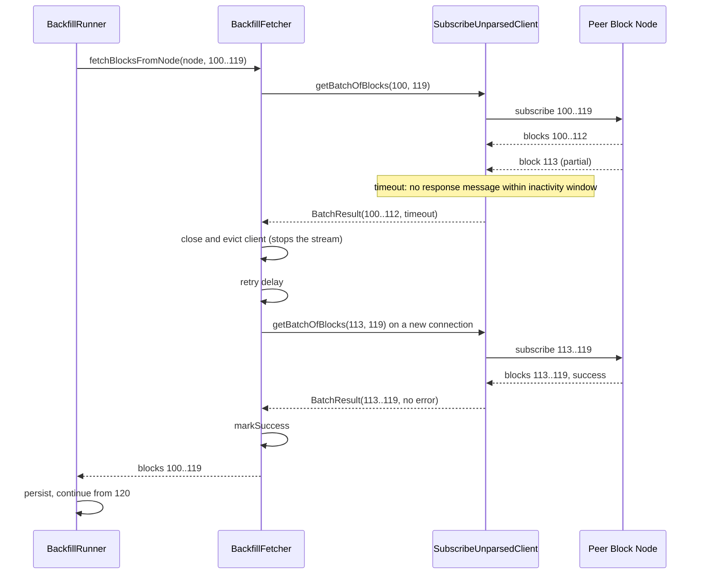
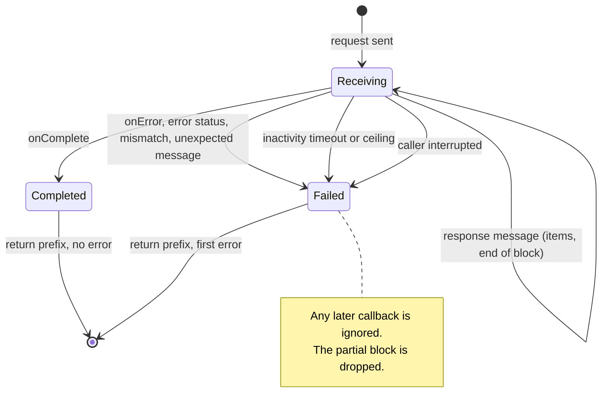
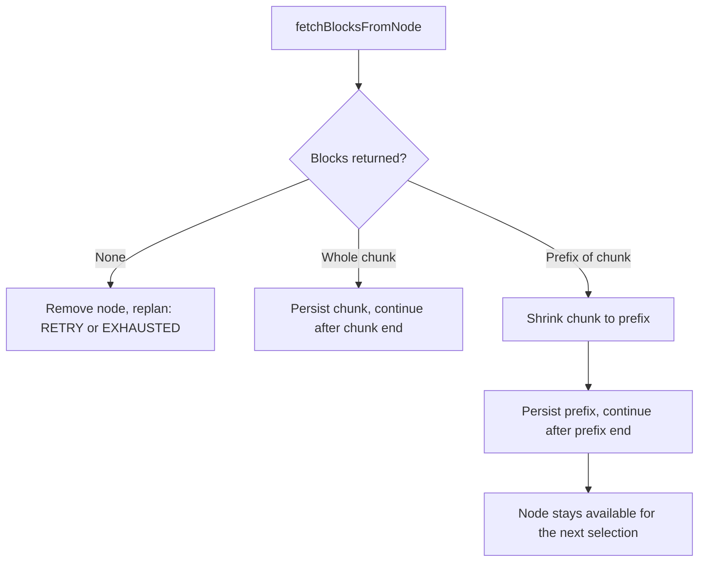

# Backfill Partial Batch Handling Design

## Table of Contents

1. [Purpose](#purpose)
2. [Goals](#goals)
3. [Terms](#terms)
4. [Entities](#entities)
5. [Design](#design)
6. [Diagram](#diagram)
7. [Configuration](#configuration)
8. [Metrics](#metrics)
9. [Exceptions](#exceptions)
10. [Acceptance Tests](#acceptance-tests)

## Purpose

Backfill fetches missing blocks from peer Block Nodes in batches, one gRPC server
stream per batch. Today a batch is all or nothing: if the stream times out or
fails, every block that already arrived is thrown away and the same full range
is requested again.

This was seen on a Block Node backfilling a range of unusually large blocks
(about 6 to 18 MB each) with `BACKFILL_FETCH_BATCH_SIZE=20`. One batch was 120 to
360 MB and took longer than the 60 second `BACKFILL_GRPC_OVERALL_TIMEOUT`, even
on a healthy connection. In one reproduction 13 of 20 blocks (about 100 MB) had
arrived when the deadline fired. The fetcher discarded them, asked for the same
20 blocks again, hit the same deadline on every retry and every cycle, and the
node never made progress.

This document describes how backfill keeps the blocks it received, how the
timeout follows progress instead of total batch time, and how a stream that
backfill has given up on is stopped. It covers the three sub-issues of epic
[#3936](https://github.com/hiero-ledger/hiero-block-node/issues/3936) together
because they change the same classes:

- [#3937](https://github.com/hiero-ledger/hiero-block-node/issues/3937) return
  the received block prefix on timeout or error and resume after it.
- [#3939](https://github.com/hiero-ledger/hiero-block-node/issues/3939) stop gRPC
  streams that backfill has abandoned.
- [#3938](https://github.com/hiero-ledger/hiero-block-node/issues/3938) use a
  progress-based timeout instead of a whole-batch deadline.

The guiding principle is: **never request again data we already hold.**

> **Companion document.** The overall backfill architecture (gap detection,
> schedulers, node selection, health score, persistence back-pressure) is
> described in [Backfill Plugin Design](./backfill-plugin.md). This document only
> changes the fetch step of that design.

The operator workaround that works without any code change, lowering
`BACKFILL_FETCH_BATCH_SIZE` (for example to 5) and raising
`BACKFILL_GRPC_OVERALL_TIMEOUT` (for example to 180000 to 300000 ms), stays valid
but is no longer required once this feature ships.

## Goals

1. A batch that partially succeeds **must** persist the blocks it received, and
   the next request **must** start right after them.
2. A block that was already received **must not** be requested again, neither on
   a retry inside the fetcher nor on the next chunk planned by the runner.
3. A block that was only partly received (items without an end of block) **must
   never** be returned or persisted. It is requested again in full, as the first
   block of the next request.
4. The result of a batch request **must** be a contiguous prefix of the requested
   range, starting at the requested start block, plus an optional error.
5. A batch that fails after at least one complete block arrived **must not**
   count as a node failure: it does not put the node in backoff and does not
   remove it from the current availability. A batch that fails before any
   complete block arrived **must** behave exactly as today.
6. A healthy but slow stream of large blocks **must** complete without tuning
   batch size and timeout together. The deadline reflects progress, and an
   absolute ceiling still bounds a peer that sends data very slowly.
7. The meaning of an existing setting **must not** change silently.
8. When a batch request returns early because of a timeout or an error, its gRPC
   stream **must** be closed.

Out of scope:

- A peer that ends the stream early with a success status. The source peer in
  the reproduction did this after 13 blocks. That is a peer-side question; this
  design makes backfill robust to it but does not fix it.
- The check-then-create race in `ZipBlockAccessor.createTempLink`, which is
  tracked separately.
- A per-stream `cancel()` on pbj's `GrpcCall` (an HTTP/2 `RST_STREAM`). It would
  let a client drop one stream without closing the connection, but backfill
  runs one stream per connection at a time, so closing the connection is enough.

## Terms

<dl>
<dt><code>Batch Request</code></dt><dd>One call to
<code>BlockStreamSubscribeUnparsedClient.getBatchOfBlocks(start, end)</code>. It
opens one gRPC server stream for a closed block range and waits for it to
finish.</dd>
<dt><code>Attempt</code></dt><dd>One batch request made by
<code>BackfillFetcher.fetchBlocksFromNode</code>. The fetcher makes up to
<code>maxRetries</code> attempts per chunk.</dd>
<dt><code>Chunk</code></dt><dd>The block range the runner asks the fetcher for,
bounded by the peer's available range, <code>fetchBatchSize</code> and the gap
end. See <a href="./backfill-plugin.md">Backfill Plugin Design</a>.</dd>
<dt><code>Prefix</code></dt><dd>The complete blocks received for a batch request,
in order, starting at the requested start block with no holes. A prefix may be
empty, cover part of the range, or cover all of it.</dd>
<dt><code>Partial Block</code></dt><dd>A block whose header and possibly some
items arrived, but whose end of block marker did not. It is never part of a
prefix.</dd>
<dt><code>Terminal Event</code></dt><dd>The first of: stream completed, stream
error, block number mismatch, unexpected response, timeout. After the terminal
event a request accepts no more data.</dd>
<dt><code>Abandoned Stream</code></dt><dd>A gRPC stream whose batch request has
already returned to the caller (because of a timeout or an error) while the peer
may still be sending data.</dd>
<dt><code>Response Message</code></dt><dd>One gRPC message of the block
stream: a set of block items, an end of block marker, or a status. The client
sees each message only once it has fully arrived.</dd>
<dt><code>Inactivity Timeout</code></dt><dd>The longest time a batch request
waits without receiving any response message from the peer.</dd>
<dt><code>Overall Timeout (Ceiling)</code></dt><dd>The longest time one batch
request may take in total, regardless of progress. Configured by
<code>BACKFILL_GRPC_OVERALL_TIMEOUT</code>.</dd>
</dl>

## Entities

### BlockStreamSubscribeUnparsedClient

The client that requests a closed range of blocks from a peer over one gRPC
stream and waits for it to finish. It now returns a `BatchResult` instead of
throwing when the stream ends early, and enforces the inactivity and overall
timeouts.

### BatchResult

New. The outcome of one batch request: the blocks received, in order from the
requested start block, and the error that ended the request early, if any.

### RequestContext and SubscribePipeline

The per-request state and the pbj pipeline that turns response messages into
blocks. The request now ends at the first terminal event, and the pipeline
ignores everything that arrives after it.

### BlockNodeClient

Holds the gRPC connections to one peer. Closing it is the only way to stop a
stream the client no longer waits for.

### BackfillFetcher

Owns the cached client and the health record of each peer, and retries a chunk
up to `maxRetries` times. It now keeps the blocks from every attempt, resumes
after them, and closes the client after a failed attempt. Each scheduler has
its own fetcher on its own thread, so a fetcher runs one fetch at a time.

### BackfillRunner

Drives one gap: selects a peer and chunk, fetches, and waits for the blocks to
persist. It now persists a partial chunk and continues after it.

## Design

### How the Code Flows Today

```
BackfillRunner.backfillGap
  -> fetchNextChunk(currentBlock, gapEnd, batchSize, availability)
       -> BackfillFetcher.fetchBlocksFromNode(node, chunk)   // up to maxRetries attempts
            -> BlockStreamSubscribeUnparsedClient.getBatchOfBlocks(start, end)
                 -> RequestContext.await(grpcOverallTimeout)  // single latch deadline
```

Blocks are lost in three places:

1. **Client.** The pipeline adds every finished block to the context, but
   `await` throws on timeout or on any error. The caller gets either every block
   or an exception, never the blocks that already arrived.
2. **Fetcher.** Every attempt requests the full chunk again. A short result marks
   the node as failed and returns an empty list; so does running out of
   attempts.
3. **Runner.** An empty list removes the node from the availability, replans,
   and persists nothing.

### Keeping the Received Blocks

A batch request no longer fails as a whole. It returns a `BatchResult`: the
blocks that arrived complete, in order from the requested start block, and the
error that ended the request early, if any. A block whose end of block marker
never arrived is not part of the result; the next request asks for it again in
full.

The request ends at its first terminal event: the stream completes, the stream
fails, the peer sends an error status or a block with an unexpected number, a
timeout trips, or the waiting thread is interrupted. Only that first event
counts. Anything the stream delivers afterwards is ignored and the
half-received block is dropped, so a stream that keeps running cannot add blocks
to a result that was already returned. This also fixes a bug where, after a
block number mismatch, the client could still add a wrong block.

### Resuming After the Received Blocks

The fetcher keeps the blocks from every attempt. Each retry starts at the first
block not yet received, so nothing the fetcher already holds is requested again.

A peer can also end the stream with a success status after sending fewer blocks
than requested, as the peer in the reproduction did after 13 of 20 blocks. There
is no error to retry in that case, so the fetcher returns the blocks it has, and
the runner asks for the rest in its next round, where node selection may pick a
different peer.

The runner persists whatever the fetcher returns and continues from the block
after it. The peer stays available for the next selection. If it cannot serve
the remaining blocks, the next fetch returns nothing and the peer is removed, as
today. Every round either persists at least one block or removes a peer, so a
gap always moves forward or ends.

A fetch counts toward the peer's health as follows:

|              Outcome              |               Health effect               |
|-----------------------------------|-------------------------------------------|
| All blocks received               | Success: failures reset, latency recorded |
| Some blocks received, then failed | None: no failure, no backoff, no latency  |
| No block received                 | Failure and backoff, as today             |

The recorded latency is the total time of the attempts, without the retry
delays between them, so the health score keeps meaning the time for a full
batch even when it took several attempts. A fetch that ends with only part of
the batch records no latency, because its time covers fewer blocks.

### Stopping Abandoned Streams

pbj 0.16.2 has no way to cancel a single gRPC stream. A stream ends only when
the peer finishes sending or the connection closes, so after a batch request
returns early, the peer keeps sending the rest of the range.

Each `BlockNodeClient` has its own connections. After every attempt that ended
with an error, the fetcher closes the client for that peer and creates a new one
for the next attempt. Closing the connection ends the abandoned stream, and the
retry never shares a connection with it. A failed attempt is already followed by
the retry delay, so the cost of new connections is small.

A `BlockNodeClient` holds two connections to its peer:

- **Stream connection.** Carries the block stream of each batch request. This is
  the connection that has to close to stop an abandoned stream.
- **Status connection.** Carries the server status queries the runner uses to
  find out which blocks each peer has, when it plans or replans a gap.

Closing the client closes both. This is safe because each fetcher runs on a
single thread, so no status query is in flight when it closes a client.

Closing the client is not a failure in itself: a peer that delivered some blocks
is not put in backoff. After a fully successful fetch the client is kept for the
next chunk, as today.

### Progress-Based Timeout

A batch request is bounded by two limits instead of one:

- **Inactivity timeout** (`grpcInactivityTimeout`, new). The request ends when
  no response message arrived from the peer for this long. Every response
  message counts, not only complete blocks. A serving Block Node splits each
  block into messages of about 1 MB (`maxChunkSizeBytes` on that node), so a
  very large block keeps the stream alive while it is being sent. A peer
  configured with much larger messages gets fewer progress signals, and needs a
  correspondingly larger inactivity timeout.
- **Overall timeout** (`grpcOverallTimeout`). The request ends when this much
  time has passed since it started, whatever the progress. It stops a peer that
  sends just enough data to stay within the inactivity timeout.

The overall timeout limits one attempt, not one chunk. A chunk gets up to
`maxRetries` attempts, so with the defaults a peer that sends just enough data
to stay within the inactivity timeout can hold a chunk for about 45 minutes:
three attempts of 15 minutes, plus the retry delays. During that time the
scheduler running the fetch starts no other chunk; the other scheduler is not
affected, and every block the peer completes is kept.

Each limit logs its own `WARNING`, so operators can tell a stalled peer apart
from a batch that did not finish in time.

pbj's per-peer read timeout (10 seconds by default) does not end a stream: it
only sends a ping and keeps reading. A stalled peer is therefore caught by the
inactivity timeout, while a peer whose connection is gone ends with a stream
error.

`BACKFILL_GRPC_OVERALL_TIMEOUT` keeps the meaning it has in the code today: the
longest time one batch request may take. An operator who set it keeps the same
cap. Its documentation also says it controls the connect, read and poll
timeouts; that stopped being true when those moved to the per-peer gRPC tuning,
and the documentation is corrected. Its default rises from 60 seconds to 15
minutes. The inactivity timeout now catches a stalled peer, and with the old
default a default installation would still fail on the large blocks described
in the [Purpose](#purpose). The change is announced in the release notes.

### Delivery Order

The three parts ship separately, in this order:

1. Keeping and resuming after the received blocks (#3937). This is the data-loss
   fix.
2. Stopping abandoned streams (#3939). It must be in place before streams are
   allowed to run longer.
3. The progress-based timeout (#3938). It changes configuration and
   documentation.

Each step is safe to release on its own. The first one alone already stops the
data loss, but a fetch that received some blocks no longer closes its
connection, so abandoned streams keep using bandwidth until the peer has sent
the rest of their range. The second one should therefore follow soon after.

Releasing the first two without the third is safe. Large blocks then make
progress under the old 60 second timeout, only more slowly, and the operator
workaround described in the [Purpose](#purpose) still applies. The third one
can follow whenever it is ready.

## Diagram

### Partial batch with resume

The reproduction from the [Purpose](#purpose) section, with this design in
place:



If every attempt had failed after block 112, the fetcher would return blocks
100..112 without marking a failure, the runner would persist them and continue
from 113.

### Request context lifecycle



### Fetch outcome handling in the runner



## Configuration

Properties use the `backfill.` prefix, set through environment variables as
shown.

|           Property            |        Environment variable        | Type |      Default       |                                          Description                                           |
|-------------------------------|------------------------------------|------|--------------------|------------------------------------------------------------------------------------------------|
| `grpcInactivityTimeout` (new) | `BACKFILL_GRPC_INACTIVITY_TIMEOUT` | int  | 20000              | Longest time in ms a batch request waits without receiving any response message. Minimum 1000. |
| `grpcOverallTimeout`          | `BACKFILL_GRPC_OVERALL_TIMEOUT`    | int  | 900000 (was 60000) | Longest time in ms one batch request may take in total. Minimum 10000.                         |
| `fetchBatchSize`              | `BACKFILL_FETCH_BATCH_SIZE`        | int  | 10                 | Unchanged. Maximum blocks per batch request.                                                   |
| `maxRetries`                  | `BACKFILL_MAX_RETRIES`             | int  | 3                  | Unchanged. Attempts per chunk; each attempt resumes after the received prefix.                 |

The two timeouts are not validated against each other. If the inactivity
timeout is set at or above the overall timeout, the overall timeout always
trips first, so the request has a single deadline, as it does today.

## Metrics

No new metrics. Existing backfill counters keep their meaning, with these
details:

- `backfill_blocks_fetched` counts every block of a returned prefix, so it now
  also grows for partial batches.
- `backfill_retries` counts each retry attempt inside the fetcher, as today.
  With this design, each of those attempts requests only the blocks after the
  prefix.

## Exceptions

- **Stream errors.** A gRPC error, a non-success status, a block number
  mismatch, an unexpected response and a parse error all end the request. They
  are returned as the `error` of the `BatchResult` together with the prefix,
  never thrown.
- **Timeouts.** The inactivity timeout and the ceiling end the request the same
  way, each with its own `WARNING` message naming the setting and the first
  block not received.
- **Interruption.** The interrupt flag is restored, the prefix is returned with
  an `InterruptedException`, and the fetcher stops retrying.
- **Late callbacks.** Any callback after the terminal event is ignored. The log
  level of `onError` now depends on when it arrives: an `onError` that ends the
  request is still logged at `WARNING`, as today, while one that arrives after
  the terminal event, typically because the connection of an abandoned stream
  was closed, is logged at `DEBUG`.
- **Exhausted attempts with a prefix.** When every attempt failed but some
  blocks arrived, the fetcher returns them and logs the last error at `WARNING`
  instead of marking the node as failed.

## Acceptance Tests

1. **Prefix on error or timeout.** A batch request that ends early returns the
   blocks received so far and the error.
2. **Partial block dropped.** A block without an end of block is never part of
   the result.
3. **Block number mismatch.** The result holds the blocks before the mismatch,
   and nothing the stream sends afterwards is added.
4. **Resume after prefix.** A retry requests only the blocks after the prefix,
   and the whole range is returned once they arrive. The peer is marked
   successful, with the time of both attempts as its latency, not counting the
   retry delay between them.
5. **Prefix kept when all attempts fail.** The prefix is returned, persisted,
   and the next fetch starts after it; the peer is not put in backoff.
6. **Short stream with success status.** The prefix is returned without
   retrying, and the rest is requested in the next round.
7. **No block received.** The peer is put in backoff and removed from the
   availability, as today.
8. **Abandoned stream closed.** After a failed attempt the client is closed and
   a new one is used for the next attempt; after a full success it is kept.
9. **Slow but steady stream.** A stream that keeps sending data completes even
   when it takes longer than the inactivity timeout.
10. **Stalled peer.** A stream that stops sending data ends after the inactivity
    timeout.
11. **Overall timeout.** A stream that keeps sending data ends at the overall
    timeout.
