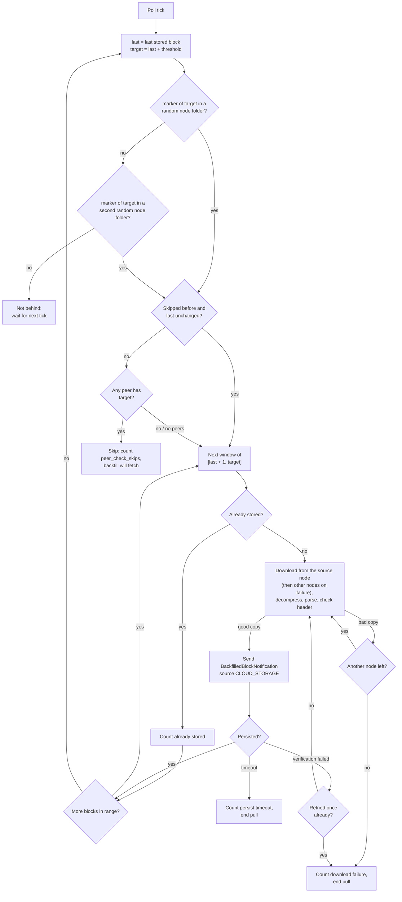
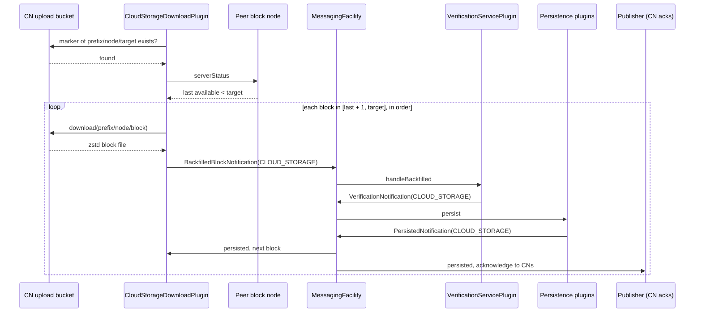

# Cloud Storage Download Plugin

## Purpose

The `cloud-storage-download` plugin observes a cloud bucket where Consensus Nodes (CNs) upload
block files, detects when this node is behind the network (a CN buffer saturation period),
downloads the missing blocks, and submits them to the existing internal verification path.

At mainnet cutover, back pressure will not be enabled on Consensus Nodes. Instead, every CN keeps
streaming to Tier 1 block nodes and also uploads each finished block file to a new cloud bucket
as a safety net. The plugin runs inside Tier 1 block nodes and frequently checks the bucket. When
the bucket is ahead of what this node has by more than a configurable number of blocks, and peer
block nodes cannot supply the blocks through backfill, it downloads one valid copy of each
missing block. It then submits the blocks to the same verification and storage path backfill
uses. Every pull is recorded with clear metrics, so we can see when streaming failed and never
mistake a recovered period for a healthy one.

This must not change behavior for Tier 2 or Mirror Node, and it is a separate plugin; the
backfill plugin is not modified.

The plugin is temporary by design. Back pressure is restored later, after a number of clean
mainnet upgrades and a stable communication period, and the bucket path is then retired. It is
expected to live roughly 3 to 6 months.

## Goals

* The plugin must detect that this block node is behind the network by a configurable number of
  blocks, using only the CN upload bucket.
* The plugin must not download anything while a peer block node can supply the missing blocks
  and backfill is fetching them; fetching from peers stays the job of the backfill plugin.
* The plugin must deliver the missing blocks strictly in block order, through the same
  verification and persistence path that backfilled blocks use.
* The plugin must tolerate a bad, missing or late copy in one CN's folder by trying another CN's
  copy of the same block.
* Blocks pulled from the bucket must be distinguishable from publisher and backfill blocks in
  notifications, metrics and logs, so that every recovery is visible to operators.
* The plugin must never write to or delete from the bucket.
* The plugin must be restart safe without any local state of its own.
* A failure of the plugin or of the bucket must never affect the publisher, backfill, health or
  any other plugin.
* The plugin must be disabled by default, so loading it changes nothing for nodes that do not
  configure it.
* The plugin must work with any S3-compatible store, including Google Cloud Storage through S3
  interoperability.
* The probe block of each pull must be persisted within 30 seconds of its consensus timestamp.
  This is the provisional latency SLO from the epic; the Mirror Node's own failover spike (10 to
  20 seconds) uses part of the same budget. Earlier blocks of the pull range are older by design,
  since the plugin acts only once the node is `aheadThresholdBlocks` behind. Where the clock
  starts is open question 3.

## Terms

* **CN upload bucket**: The read-only bucket the consensus nodes upload their block files to.
  Owned and operated outside the block node (Execution and DevOps).
* **Node folder**: The part of the bucket written by one consensus node: `<prefix>/<node-id>/`.
* **Marker file**: A file a CN writes next to a block file once the block file is completely
  written, the equivalent of the `.sig` file for record files. It is uploaded to the node folder
  with the block file. Its name is set by the Execution team.
* **Copy**: One CN's upload of a given block, found at that block's key inside that CN's node
  folder. Every CN uploads its own copy of every block.
* **Last stored block**: The highest block number this block node has stored, from any source
  (publisher, backfill or this plugin). Taken from the Application State facility.
* **Threshold**: How many blocks behind the network the node must be before the plugin acts
  (`aheadThresholdBlocks`). Set a little below the CN buffer limit.
* **Probe**: The check run every poll interval: does the marker file of block
  `last stored + threshold` exist in the bucket?
* **Probe block (target)**: `last stored + threshold`, the block the probe looks for.
* **Pull range**: `[last stored + 1, target]`, the blocks downloaded and submitted once the probe
  finds the probe block and no peer can supply it.

## Entities

### `CloudStorageDownloadPlugin`

Implements `BlockNodePlugin`, `BlockNotificationHandler` and the application state notification
handler. Owns a single-thread scheduled executor that runs the probe, the peer check, the
download and the submission. Downloads within one window run in parallel on virtual threads.

### `CloudStorageDownloadConfig`

`@ConfigData("cloud.storage.download")` record holding every setting listed under
[Configuration](#configuration). Credentials are not `@Loggable`.

### Bucket access

The plugin uses `com.hedera.bucky.S3Client` directly, with no wrapper interface. It calls only
bucky's read methods, never an upload or delete method. Both the existence check and the
download use `openObjectStream(key)`, which returns `null` when the object does not exist and
throws `S3ResponseException` only for other errors.

Tests exercise bucket behavior against a real S3-compatible store (RustFS), where missing,
corrupt and late objects are simply staged in the bucket. Where a unit test needs a failure that
is hard to stage, it stubs `S3Client` with Mockito, which can mock final classes.

### `BlockSource.CLOUD_STORAGE`

A new value of the `BlockSource` enum, carried on every notification about a block that came
from the bucket. See [Block source](#block-source).

### `BackfilledBlockNotification`

Gains a `source` field. The existing two-argument constructor defaults it to `BACKFILL`, so the
backfill plugin is not changed.

## Design

### Bucket layout

Each block is stored at:

```
<prefix>/<node-id>/AAAA/BBBB/CCCC/DDDD/EEE.blk.zstd
```

* `<prefix>` comes from `objectKeyPrefix`, the same property the other cloud plugins have. Empty
  means no prefix.
* `<node-id>` is the ID of the consensus node that uploaded the block.
* The remainder is exactly the `cloud-storage-expanded` per-block layout.

For example, block `108273182` uploaded by node `3` with prefix `blocks` is
`blocks/3/0000/0000/0010/8273/182.blk.zstd`.

The object is the CN's TSS-signed block file, unmodified: a protobuf `Block`, compressed with
zstd. The block node already reads this format (`CompressionType.ZSTD`).

Each node folder also holds the CN's marker files, one next to each block file. The marker's key
is derived from the block's key by a fixed rule set by the CN uploader's format; like the archive
layout, it is a constant in the plugin, not configuration. The probe checks for the marker of
the probe block, not for the block file: a block file is complete only once its marker exists.

The plugin never lists the bucket. It builds keys only for node IDs it already knows.

### Where the inputs come from

All inputs come from the Application State facility; the plugin keeps no state on disk.

* **Last stored block:** the end of the highest range in `storedBlocks()`, kept current from
  `StoredBlocksNotification`. `-1` when nothing is stored. Because it includes blocks from every
  source, a block that backfill already fetched is never pulled again.
* **Node IDs:** `node_id` of every entry in `tssData().currentRoster()`, read in `start()` and
  refreshed on every `TssDataNotification`, so a node added at an upgrade is picked up. On a
  network without TSS data, the address book history gives the node IDs instead.
* **Peers:** `backfillSources()`, the peer block nodes the backfill plugin registered. Read at
  every peer check, not in `start()`, since backfill may register them later. Empty when
  backfill is not loaded or has no sources, which means "no peer can help".

### Probe

Once per `pollIntervalMs`:

1. `last` = last stored block.
2. `target = last + aheadThresholdBlocks`.
3. Pick a random node ID and check whether the marker file of `target` exists in that node folder.
   If it does not, try one more random node, since a single slow or failed CN must not hide that
   this node is behind.
4. Not found: the node is not behind by the threshold. Wait for the next poll.
5. Found: the node is behind. Run the peer check. If no peer has the blocks, download and submit
   the pull range. When the pull range is done, probe again at once rather than waiting for the
   next poll, since `last` has moved and the bucket may still be ahead.

The plugin never tries to find the bucket's latest block. S3 and GCS list only in ascending key
order, so that would need a walk of every node folder on every poll. Asking "is the probe block
there?" costs one GET. After a pull a tail shorter than the threshold can remain; that tail is
left to the publisher and backfill, since the CNs still hold those blocks.

### Peer check

The plugin never downloads blocks from peer block nodes. It only asks them whether they have the
missing blocks, to decide whether a bucket pull is needed at all.

The plugin calls `serverStatus` through `BlockNodeClient` (in `base`) on every peer from
`backfillSources()` in parallel. The whole check is bounded by a short `peerCheckTimeoutMs`,
however many peers there are, and ends early once one peer reports `target`; a peer that has not
answered by then counts as not having the blocks. If any peer's last available block is at least
`target`, the plugin skips this pull, counts it, and leaves the blocks to backfill. The next
probe checks again. With no peers registered, the plugin goes straight to the pull.

A skip holds only while backfill makes progress. The plugin remembers `last` at the skip. If the
next probe finds the node still behind and `last` has not moved since then, backfill is not
fetching the blocks (it is not greedy, its next scan is far off, or it is failing), and the
plugin pulls without a peer check. This costs at most one poll interval of extra delay and needs
no knowledge of backfill's configuration.

During a real CN saturation every Tier 1 is behind at the same time, so the check normally
answers "no" quickly. The short timeout keeps an unresponsive peer from eating into the latency
budget.

### Download and fallback

The whole pull range is downloaded from the node folder in which the probe found the probe block
(the source node). That CN has uploaded at least up to `target`, so its folder most likely holds
every block in the range. Other node folders are used only for a block the source node cannot
supply.

The pull range is processed in windows of `downloadWindow` blocks. For each block:

1. Skip it if the stored ranges already contain it (the publisher or backfill got there first)
   and count it as already stored.
2. Download the copy from the source node, decompress it, parse it as `BlockUnparsed`, and check
   that the first item is a block header with the expected block number.
3. If the copy is missing or unusable (missing object, bad zstd, parse error, wrong number), log
   at DEBUG with the node ID and reason, count a rejected copy (except a plain 404), and try the
   same block in the other node folders, one at a time, until one supplies a usable copy. A
   request that times out or fails with an S3 error is not a bad copy: it counts a request
   failure and ends this pull (see [Exceptions](#exceptions)), since the bucket itself is likely
   stalled.
4. If no node folder supplies a usable copy, count a download failure and end this pull. The
   next poll starts again from the new last stored block.

A fallback applies only to the block that needed it; the next block is again downloaded from the
source node.

Downloads within a window run in parallel; their results are submitted strictly in block order.

These checks only filter copies that are obviously broken, so that verification sessions are
not wasted on them. Proof and chain verification stay in the verification plugin.

### Submit and wait

For each downloaded block, in order, the plugin sends

```java
new BackfilledBlockNotification(blockNumber, block, BlockSource.CLOUD_STORAGE)
```

and waits for a successful `PersistedNotification` for that block number before moving on, the
same way backfill waits for each chunk. Any source ends the wait: if the publisher or backfill
persists the block first, the plugin does not wait for its own copy. Within a pull the plugin
never resends a submission, since a resend would race the first one through verification.

The wait is bounded by `persistWaitTimeoutMs`. If the block is not persisted by then, the plugin
logs it, counts a persist timeout, and ends the pull, so a lost notification cannot park the
poll thread for good. The next poll recomputes `last` from the stored blocks: a block that
persisted late is skipped as already stored, and only a block that really never came back is
submitted again.

Submitting in order and waiting for each block keeps the plugin within the verification plugin's
active session buffer and satisfies its result ordering, which already applies to sources other
than the publisher. It also handles block 0 correctly, which must persist before later blocks.

If verification fails for a `CLOUD_STORAGE` block, the plugin first checks the stored ranges.
If the block is stored by now, another source persisted it in the meantime: the plugin counts it
as already stored and moves on. Otherwise it counts a verification failure and retries that block
once from a different node's copy, since the copy may be bad. If that fails too, the pull ends.

### Acknowledgement

The plugin sends nothing to the CNs. The publisher acknowledges every successfully persisted
block whatever its source, so a block pulled from the bucket is acknowledged on the publish API
once it is persisted, like a block that arrived from a publisher or from backfill. The
acknowledgement goes to every connected CN, and each CN can then drop that block and the ones
before it from its buffer.

The publisher never acknowledges past a gap. This is why the plugin submits the pull range in
order, starting at `last stored + 1`, and waits for each block to be persisted before submitting
the next: each block it pulls moves the acknowledgement forward by one.

### Block source

Bucket blocks reuse the backfill notification, so the plugin needs no new ingest path, but they
carry a new `BlockSource.CLOUD_STORAGE` instead of `BACKFILL`:

* `VerificationServicePlugin.handleBackfilled` takes the source from the notification instead
  of hard-coding `BACKFILL`, and accepts only `BACKFILL` and `CLOUD_STORAGE`.
* `BlockSessionHandler` treats `CLOUD_STORAGE` like `BACKFILL` and passes the source through to
  the verification and persisted notifications.

`BACKFILL` cannot be reused. The backfill plugin reacts to every `BACKFILL` persisted and
verification notification: it counts each one as a backfilled block, and on failure it queues
the block to fetch again from peers. Tagged as `BACKFILL`, every bucket pull would be reported
as a backfill, hiding the very publisher failure the plugin exists to reveal, and every bad CN
copy would send backfill chasing peers for it.

With the new value no other plugin changes:

* The publisher acknowledges bucket blocks like any other persisted block (see
  [Acknowledgement](#acknowledgement)), advances its cursor past them, and reacts to failures
  only for `PUBLISHER` blocks.
* Backfill ignores `CLOUD_STORAGE` blocks.
* The persistence and archive plugins pass the source through.

### Duplicates

When streaming resumes, the publisher and the plugin may deliver the same block, and backfill
and the plugin may too if a peer catches up mid-pull. The plugin skips blocks already stored
before downloading them, which avoids most duplicates. A block another source persists after
that check is still submitted. A valid copy is verified and written again, identical to the
first. A failed one (for example a session evicted from the verification buffer) is recognized
by the stored-ranges check above and counted as already stored, not as a bad copy, so the pull
continues. No extra coordination is needed.

### Restart

The plugin keeps no cursor. Every probe recomputes `last` from the stored ranges, so after a
restart it continues from wherever storage is, whichever source stored the blocks. A cursor file
would only duplicate what storage already knows.

### Slow or failing storage

Cloud behavior differs: S3 has been seen to blip past 5 minutes, GCS up to about 90 seconds. The
plugin runs on its own executor with a per-request timeout. A stalled or failing bucket is
counted in `cloud_download_request_failures`, logged and retried on the next poll. It never
touches health, the publisher or backfill, and never shuts the server down: the plugin is a
safety net, not a load-bearing part of ingest.

### Logging

Each pull logs one INFO line when it starts (`last`, `target`) and one when it ends (range
pulled, block count, duration). Per-block detail is at DEBUG or TRACE. Block numbers and
timestamps cannot be metric labels, so these log lines are the record of exactly which blocks
were pulled and when. Levels follow `docs/logging-guidelines.md`.

### Configuration validation

When `enabled` is `true`, `bucketName`, `endpointUrl`, `regionName`, `accessKey` and `secretKey`
must not be blank, and `aheadThresholdBlocks` and `downloadWindow` must be positive. A missing
setting is logged at WARNING (names only, never values) and the plugin stays inactive; the rest
of the node runs normally.

`aheadThresholdBlocks` has no default until open question 2 settles one. This is intended: an
operator who enables the plugin before then must set the threshold for their network, and the
validation above rejects a missing one rather than guessing.

## Diagram

### Poll loop



### Block path through the node



## Configuration

All properties are under the `cloud.storage.download` namespace.

|        Property        | Default |                                             Description                                              |
|------------------------|---------|------------------------------------------------------------------------------------------------------|
| `enabled`              | `false` | Master switch. When `false` the plugin does nothing.                                                 |
| `endpointUrl`          | `""`    | S3-compatible endpoint, for example `https://storage.googleapis.com` for GCS. Required when enabled. |
| `regionName`           | `""`    | Region of the bucket. Required when enabled.                                                         |
| `bucketName`           | `""`    | Name of the CN upload bucket. Required when enabled.                                                 |
| `accessKey`            | `""`    | Read-only access key (HMAC key for GCS). Not logged. Required when enabled.                          |
| `secretKey`            | `""`    | Read-only secret key. Not logged. Required when enabled.                                             |
| `objectKeyPrefix`      | `""`    | `<prefix>` in `<prefix>/<node-id>/<archive>`. Empty means no prefix.                                 |
| `pollIntervalMs`       | `5000`  | Time between probes.                                                                                 |
| `aheadThresholdBlocks` | TBD     | The probe block is `last stored + this`. Must be positive and a little below the CN buffer limit.    |
| `downloadWindow`       | `10`    | Blocks downloaded in parallel before being submitted in order. Must be positive.                     |
| `requestTimeoutMs`     | `10000` | Timeout for one bucket request.                                                                      |
| `persistWaitTimeoutMs` | `90000` | How long to wait for the persisted notification of one block before ending the pull.                 |
| `peerCheckTimeoutMs`   | `2000`  | Overall limit for the peer check; peers are queried in parallel.                                     |

The following are deliberately not configuration:

* The archive path layout, which is the same as the `cloud-storage-expanded` plugin's.
* The marker file's name, which is fixed by the CN uploader's format.
* The node IDs, which come from the roster.
* The peer list, which comes from the backfill plugin's registered sources.
* Retry policy details, which use bucky's default `RetryPolicy`.

Credentials can also be supplied as environment variables (`CLOUD_STORAGE_DOWNLOAD_ACCESS_KEY`,
`CLOUD_STORAGE_DOWNLOAD_SECRET_KEY`), like the other cloud plugins.

## Metrics

All metrics are registered under the `blocknode` category. The exporter appends `_total` to
counters, so the keys below do not end in it.

|                 Metric                 |  Type   |                                                Description                                                 |
|----------------------------------------|---------|------------------------------------------------------------------------------------------------------------|
| `cloud_download_blocks_pulled`         | counter | Blocks persisted from the bucket.                                                                          |
| `cloud_download_blocks_already_stored` | counter | Blocks in a pull range skipped because the publisher or backfill stored them first.                        |
| `cloud_download_copies_rejected`       | counter | Copies discarded before submission (bad zstd, parse error, wrong block number).                            |
| `cloud_download_download_failures`     | counter | Blocks for which no node folder had a usable copy.                                                         |
| `cloud_download_verification_failures` | counter | `CLOUD_STORAGE` blocks that failed verification.                                                           |
| `cloud_download_peer_check_skips`      | counter | Pulls skipped because a peer block node had the blocks.                                                    |
| `cloud_download_persist_timeouts`      | counter | Pulls ended because a submitted block was not persisted within `persistWaitTimeoutMs`.                     |
| `cloud_download_request_failures`      | counter | Bucket requests (probe or download) that timed out or failed with an S3 error; a plain 404 is not counted. |

`cloud_download_blocks_pulled` is the recovery signal. It feeds the decision to re-enable back
pressure, which requires several network upgrades with no unexplained bucket recoveries, so any
non-zero value deserves an alert and an explanation.

The epic also lists a gauge of how far the bucket is ahead of this node. It is not measured: the
plugin only checks whether the probe block exists and never looks for the bucket's latest block,
so that distance is unknown.

## Exceptions

|                 Condition                 |                                                     Handling                                                     |
|-------------------------------------------|------------------------------------------------------------------------------------------------------------------|
| Required setting blank while enabled      | WARNING naming the setting; plugin stays inactive; node runs normally.                                           |
| bucky client fails to initialise          | WARNING; plugin stays inactive.                                                                                  |
| 404 for a block in one node folder        | Not an error; try the next node folder.                                                                          |
| Bad zstd, parse error, wrong block number | DEBUG; `copies_rejected` incremented; try the next node folder.                                                  |
| No node folder has a usable copy          | `download_failures` incremented; pull ends; next poll starts again.                                              |
| Request timeout or S3 error               | `request_failures` incremented and logged; pull ends; next poll starts again. Never propagated to other plugins. |
| Peer status query fails or times out      | That peer is treated as not having the blocks.                                                                   |
| Verification fails for a pulled block     | `verification_failures` incremented; retried once from another node folder; then the pull ends.                  |
| No persisted notification in time         | `persist_timeouts` incremented and logged; pull ends; next poll starts again from the last stored block.         |
| `RuntimeException` in the poll task       | Caught and logged at WARNING so the scheduled task keeps running.                                                |

The plugin is fault-isolated: nothing it does can stop the publisher, backfill or the server.

## Acceptance Tests

### Unit

1. **Key layout:** block `108273182`, node `3`, prefix `blocks` gives
   `blocks/3/0000/0000/0010/8273/182.blk.zstd`; an empty prefix gives no leading `/`; the
   archive part matches the examples in the `cloud-storage-expanded` design (blocks `1`,
   `1234567` and `108273182`).
2. **Disabled by default:** with default configuration the plugin makes no bucket requests.
3. **Configuration validation:** blank required settings, zero threshold and zero window are
   rejected when enabled.
4. **Nothing stored yet:** with `last = -1` the probe block is `threshold - 1`.
5. **Not behind:** probe block absent in two node folders; no pull.
6. **Behind by exactly the threshold:** probe block present; the pull range is
   `[last + 1, last + threshold]`, submitted in order.
7. **One node folder missing the probe block:** the second random node finds it.
8. **Roster update:** a `TssDataNotification` adding a node makes its folder eligible.
9. **Back-to-back pulls:** after a pull completes and the bucket is still ahead, the next probe
   runs at once.
10. **Peer check:** no peers registered (pull), a peer has `target` (skip, counted), all peers
    behind (pull), a peer times out (treated as behind). After a skip, a probe that finds `last`
    moved runs the peer check again; a probe that finds `last` unchanged pulls without one.
11. **Source node:** every block of the pull range is downloaded from the node folder in which
    the probe found the probe block.
12. **Fallback:** the source node's copy is corrupt, has the wrong block number, or is missing;
    another node's copy is used for that block only, and the next block comes from the source
    node again. All copies bad gives a download failure and ends the pull.
13. **Already stored:** a block stored by the publisher during the pull is skipped and counted.
    A block the publisher persists after the plugin submitted it ends the wait, and a
    verification failure for it is counted as already stored, not as a verification failure.
14. **Verification failure:** the block is retried once from another node; a second failure
    ends the pull.
15. **Persist timeout:** a persisted notification later than `persistWaitTimeoutMs` ends the pull
    without a second submission and increments `cloud_download_persist_timeouts`; when the
    notification arrives before the next poll, that poll skips the block as already stored.
16. **Metrics:** each metric moves as described in scenarios 5 to 15, and a stubbed request
    timeout or S3 error increments `cloud_download_request_failures` while a 404 does not.
17. **Verification source:** a `CLOUD_STORAGE` backfilled notification yields verification and
    persisted notifications carrying `CLOUD_STORAGE`; the backfill plugin ignores them; the
    publisher acknowledges them.

### Integration (RustFS)

Each test runs the real plugin against a RustFS container. The bucket holds node folders for
three node IDs, seeded by the test with zstd blocks in the expanded per-block layout, and the
plugin is given a roster with those three IDs. The stored blocks are preset by the test, and a
test messaging facility answers every submission with a successful persisted notification and
records the order of submissions. Real verification is not part of these tests; it is covered by
unit test 17 and the end-to-end tests.

18. **Existence check:** for an object that exists, `openObjectStream` returns a stream; for a
    key that does not exist, it returns `null` rather than throwing.
19. **Not behind:** the bucket holds blocks only up to `last + threshold - 1`. After several polls
    no block has been downloaded or submitted.
20. **Pull from the source node:** all three folders hold `[last + 1, target]`. Every block is
    downloaded from the folder in which the probe found `target`, and the blocks are submitted
    in order. `cloud_download_blocks_pulled` equals the size of the pull range.
21. **Fallback for one block:** in the source node's folder one block is corrupt and another is
    missing. Those two blocks come from another folder, every other block from the source node,
    and all are submitted in order. `cloud_download_copies_rejected` is 1.
22. **All copies bad:** one block is corrupt or missing in every folder. The blocks before it
    are submitted, that block and the ones after it are not, and
    `cloud_download_download_failures` is 1. The next poll starts again from the last stored
    block.
23. **Key prefix and marker:** with a non-empty `objectKeyPrefix` and with an empty one, blocks
    are found at the right keys. A probe block whose marker file is missing is treated as absent
    even though the block file exists.
24. **Slow store:** a Toxiproxy proxy in front of RustFS adds latency above `requestTimeoutMs`.
    Requests time out, `cloud_download_request_failures` increases, no exception escapes the
    plugin, and once the latency is removed the next poll pulls normally.
25. **Stopped store:** the RustFS container is stopped during a pull. The pull ends,
    `cloud_download_request_failures` increases, no exception escapes the plugin, and after the
    container is restarted the next poll resumes from the last stored block.
26. **Bad configuration at startup:** wrong credentials, a missing bucket and an unreachable
    endpoint each leave the plugin inactive with a WARNING. No exception escapes `start()`, and
    the plugin makes no further requests.
27. **Restart:** the plugin is stopped in the middle of a pull and started again with the stored
    blocks moved on to the last persisted block. Its first probe is computed from those stored
    blocks, and it submits only the blocks that were not yet persisted.
28. **Read-only credentials (optional):** the plugin runs with credentials limited to reads by a
    RustFS policy, and a full pull succeeds. This proves the plugin never writes to the bucket.
    Dropped if RustFS does not support such policies.

The tests use a pinned RustFS image, the same S3 server the Solo E2E archive topology uses. GCS
S3 interoperability is verified on PreviewNet.

### End to end (Solo)

These tests need CNs that upload their block files to a bucket in the Solo cluster (RustFS). Until
a CN build with the upload is available in Solo, a bash script uploads blocks to that bucket from
a block node's own `cloud-storage-expanded` output, in the `<prefix>/<node-id>/<archive>` layout.

29. **One Tier 1 blocked:** the publish port of one Tier 1 is blocked while the other Tier 1s keep
    receiving blocks, and backfill's `scanInterval` is set below the poll interval. The blocked
    node catches up through backfill from its peers; `cloud_download_peer_check_skips` increases
    and `cloud_download_blocks_pulled` stays 0. With `backfill.greedy=false` on that node instead,
    the plugin pulls after one skip.
30. **All Tier 1s blocked past the CN buffer:** the publish ports of all Tier 1s are blocked for
    longer than the CN buffer covers, so the CNs no longer hold the oldest missing blocks. After
    unblocking, a Tier 1 catches up from the bucket with a gap-free chain,
    `cloud_download_blocks_pulled` increases, and the other Tier 1s backfill from it.
31. **Streaming resumes mid-pull:** the publish ports are unblocked while a pull is running. The
    publisher and the plugin both deliver blocks; no publisher stream is torn down, no error is
    raised, and `cloud_download_blocks_already_stored` increases.
32. **Acknowledgement:** the acknowledgements the CNs receive on the publish API cover the blocks
    pulled from the bucket.
33. **Downstream unchanged:** after recovery, a Tier 2 block node and the Mirror Node receive
    the recovered blocks from Tier 1 through the normal stream, without accessing the bucket.
34. **Roster change and key rotation** during the outage: pulled blocks still verify.
35. **Latency:** the probe block of each pull is persisted within 30 s of its consensus
    timestamp, also with an injected storage stall shorter than `requestTimeoutMs`. The pull's
    end log line and the block's consensus timestamp give the measurement.

## Open Questions

These are to be settled in the design review.

1. **Marker file:** the exact name of a block's marker file relative to its block file, and
   confirmation that mirror.py uploads it to the bucket. The name is hard-coded in the plugin, so
   it is needed before implementation, not only before deployment. The key layout itself must be
   confirmed with Execution as written above.
2. **Defaults:** the threshold (a little under the CN buffer limit, in blocks), the poll
   interval (proposed 5 s) and the download window. The two are tied: a probe can find the node
   behind up to one poll interval after it crossed the threshold, and that delay comes out of the
   margin left before the CN buffer fills. The poll interval must therefore stay below
   `(CN buffer limit - threshold) x block time`. The poll interval, the peer check and the
   persist round trip of every block in the pull range also come out of the 30 s latency budget,
   so the threshold bounds the pull's duration as well as the CN buffer margin.
3. **Latency clock:** where the 30 s SLO clock starts. Proposal: the consensus timestamp of the
   probe block, read from its block header, so no extra request is needed. Measured from the
   first missing block the SLO cannot be met: the probe fires only once the node is
   `aheadThresholdBlocks` behind, which at about 2 s per block exceeds 30 s for any threshold
   above roughly 15 blocks.
