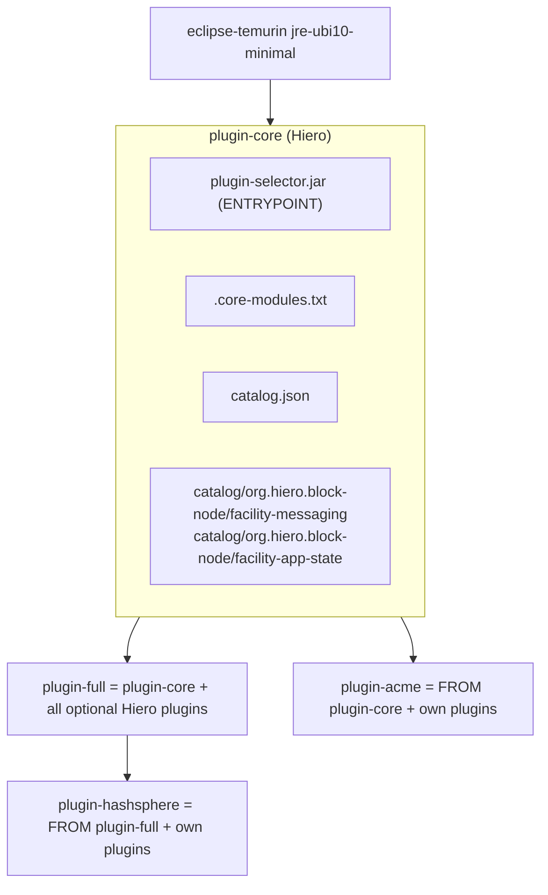
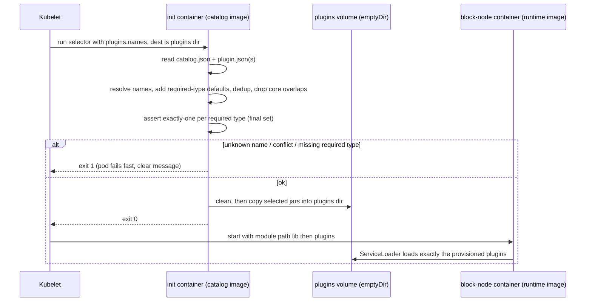
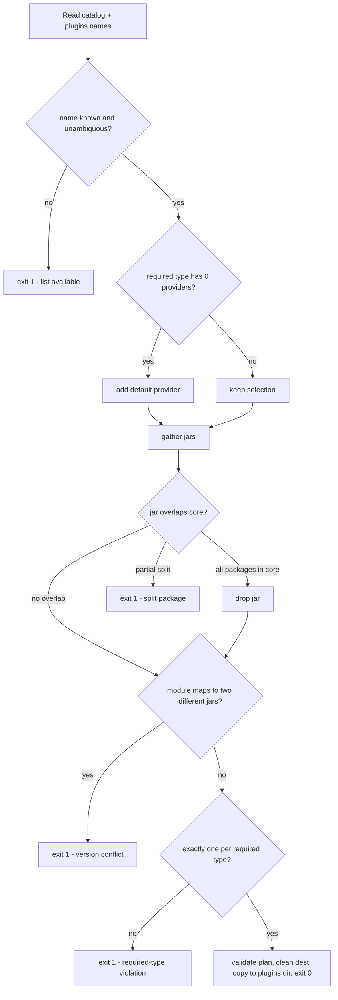

# Plugin Catalog & Selector

## Table of Contents

1. [Summary](#summary)
2. [Goals](#goals)
3. [Non-Goals](#non-goals)
4. [Background: How Plugins Load Today](#background-how-plugins-load-today)
5. [Terms](#terms)
6. [Entities](#entities)
7. [Design](#design)
   - [Catalog Format](#catalog-format)
   - [The Selector Program (Java)](#the-selector-program-java)
   - [Required Plugin Types](#required-plugin-types)
   - [Image Layering](#image-layering)
   - [Adding a Plugin to the Catalog](#adding-a-plugin-to-the-catalog)
8. [Diagrams](#diagrams)
9. [Configuration](#configuration)
10. [Metrics](#metrics)
11. [Exceptions & Failure Modes](#exceptions--failure-modes)
12. [Acceptance Tests](#acceptance-tests)
13. [Coverage of solo-operator#1434](#coverage-of-solo-operator1434)
14. [Alternatives Considered](#alternatives-considered)

> **Note:** This is a design document. Some implementation details may differ from the current
> release. For the current plugin list and Helm configuration, see the
> [plugins architecture doc](../block-node/architecture/plugins.md) and the
> [chart README](../../charts/block-node-server/README.md).

## Summary

Block Node deployments need a way to provision plugins ideally without Maven and without network
access at pod start, while allowing operators to add community or user-developed plugins on equal
footing with Hiero-developed plugins.

We are proposing an extensible plugin catalog system for Block Node such that the community is
allowed to load any plugin they want and they are free to extend the plugin catalog as they prefer.

Two components are proposed (assuming a Kubernetes-native deployment model):

- **Extensible plugin catalog system:** the plugin catalog is delivered as container image layers
  that run as init containers (ensures no network access at pod start).
- **Selector program (`plugin-selector`):** provisions a chosen plugin subset before Block Node
  starts, during init (deterministic conflict resolution and idempotent placement).

The proposal keeps the Block Node runtime image unchanged, preserves the existing Maven and
`solo-dev` paths, and treats Hiero and community plugins identically at runtime.

### Why not today's paths

1. **Minimal image + Maven init containers** (production Helm). A `resolve-plugins` init container
   runs Maven against `plugins.names` / `plugins.thirdParty` on every config change. It requires
   egress to Maven Central and Sonatype snapshots, so air-gapped or egress-restricted clusters
   cannot use it, and a Central outage blocks Block Node starts. The resolved plugin set is not part
   of any image digest, so it is not reproducible, scanned, or signed with an image, and it can
   drift from the core version via snapshot timestamps.
2. **`solo-dev` image.** Bakes every plugin into the image and ships `sudo`/`yum`/dev tools. It is
   deliberately scoped to local development and is not appropriate for production; it also cannot
   select a plugin subset, so operator-managed nodes always run every plugin.

## Goals

1. Provision plugins at pod start with **no Maven and no network egress**.
2. Make the provisioned plugin set **reproducible** and pinned to an image digest (for what Hiero
   builds).
3. Let a **community/third-party operator add their own plugins** that are treated identically to
   Hiero plugins at runtime. The operator's only obligation is to base their plugin image off a
   Hiero-published base image.
4. Keep **selection driven by the existing `plugins.names` Helm value** — no new selection
   vocabulary, and existing profiles keep working unchanged.
5. **Enforce required plugin types** at provisioning time, with a loud, early failure (not a silent
   mis-boot), while still allowing replaceable facilities to be replaced.
6. Keep the **block-node runtime image unchanged** (no plugins baked into it).
7. Reuse the existing Java/Gradle toolchain and JRE base image.

## Non-Goals

- Replacing or deprecating the Maven init-container path or the `solo-dev` image.
- "Scanning everything that is deployed." Hiero scans and signs what Hiero builds; the deployed
  system is intentionally not entirely within Hiero's control (operators add their own plugins).
  This is a deliberate product decision, not a gap to close.
- Runtime enable/disable of plugins via configuration. Plugin selection remains a function of what
  is on the module path; this design decides what lands there **before** the JVM starts.
- Mounting a container image directly as a volume. That requires Kubernetes 1.35+ with
  containerd > 2.1.x (or 1.36+ with CRI-O 1.36+) and is too new to depend on.
- A runtime cross-check that the catalog's core version matches the running core. In v1 the catalog
  image is built and shipped at the same version as its base; a `builtAgainstCore` mismatch warns
  (see [Configuration](#configuration)).

## Background: How Plugins Load Today

Plugins are discovered with a plain JPMS `ServiceLoader` over everything on the module path:

```java
// ServiceLoaderFunction.java
return ServiceLoader.load(serviceClass).stream().map(ServiceLoader.Provider::get);
```

`BlockNodeApp` loads `BlockNodePlugin` providers (and specific facility interfaces) from the module
path. There is **no enable/disable configuration** — a plugin runs if, and only if, its jar is on
the module path. The start script fixes the module path as:

```
MODULE_PATH=$APP_HOME/lib/:$APP_HOME/plugins/
```

- `lib/` holds **core jars only** (the `mainModuleInfo` runtime dependencies). The published OCI
  image ships no plugins.
- `plugins/` is **empty** in the base image and is the single runtime sink that provisioning fills.

**Consequence that drives this whole design:** plugin selection is a *file-placement* decision made
*before* JVM start. Whatever ends up in `plugins/` is loaded. An environment variable cannot make
the JVM ignore a jar that is already on the module path — so selection must happen by choosing which
jars are copied into `plugins/`.

The required facilities are **catalog plugins, not core jars**. `facility-app-state` and
`facility-messaging` are declared in the `blockNodePlugins` Gradle configuration, not in the app's
runtime dependencies, so they arrive only via `plugins/`. `BlockNodeApp` loads them by *interface*:

```java
loadServices(BlockMessagingFacility.class).findFirst()
    .orElseThrow(() -> new IllegalStateException("No BlockMessagingFacility provided"));
loadServices(ApplicationStateFacility.class).findFirst()
    .orElseThrow(() -> new IllegalStateException("No ApplicationStateFacility provided. The"
        + " facility-app-state plugin is required; ..."));
```

So the app already crash-loops loudly if a required facility is missing — this design surfaces the
same error earlier, at provisioning time. Note that existing plugin profiles already list the
facilities in `plugins.names` (e.g. `plugin-profile-minimal.yaml` =
`facility-app-state,facility-messaging,block-access-service,health,server-status`), so the selector
mostly copies exactly what is named; required-type handling is a safety net, not the main path.

## Terms

<dl>
  <dt>Catalog</dt>
  <dd>A directory tree of available plugins, each in its own directory with its non-core dependency
      closure and a descriptor. Shipped inside a container image.</dd>

  <dt>Catalog entry</dt>
  <dd>One plugin: a directory <code>catalog/&lt;group&gt;/&lt;name&gt;/</code> containing the plugin
      jar, its non-core transitive dependency jars, and a <code>plugin.json</code>.</dd>

  <dt>Selector</dt>
  <dd>A Java program (<code>plugin-selector</code>) that reads the catalog, resolves the requested
      selection from <code>plugins.names</code>, enforces required types, deduplicates, and copies
      the chosen jars into the runtime <code>plugins/</code> directory. Runs as the init container.</dd>

  <dt>Plugin type</dt>
  <dd>A service interface a plugin provides (e.g. <code>BlockMessagingFacility</code>,
      <code>ApplicationStateFacility</code>, <code>BlockNodePlugin</code>). Declared in each
      entry's <code>plugin.json</code> and derivable from the jar's <code>module-info</code>
      <code>provides</code> clauses.</dd>

  <dt>Required type</dt>
  <dd>A plugin type of which the running node must have <strong>exactly one</strong> provider, or it
      will not boot. Currently <code>BlockMessagingFacility</code> and
      <code>ApplicationStateFacility</code>.</dd>

  <dt>Core overlap</dt>
  <dd>A plugin dependency jar whose Java packages already exist in <code>lib/</code> (core). Such a
      jar must be dropped, or JPMS fails at boot with a split-package / duplicate-module error.</dd>
</dl>

## Entities

| Entity | What it is | Who builds it |
|---|---|---|
| **block-node runtime image** | Existing minimal image: JRE + `lib/` (core) + empty `plugins/`. **Unchanged by this design.** | Hiero |
| **`plugin-core` image** | Selector program + required facilities (`facility-messaging`, `facility-app-state`) and their configs + `catalog.json` + `.core-modules.txt`. The mandatory base all catalog images extend. | Hiero |
| **`plugin-full` image** | `FROM plugin-core` + all optional Hiero plugins. The batteries-included default for normal Hiero / Solo deployments. | Hiero |
| **`plugin-acme` / `plugin-hashsphere`** | Community/operator images: `FROM plugin-core` (lean) or `FROM plugin-full` (Hiero-all + own) + their own catalog entries. | Operator |
| **selector** | Java program (`plugin-selector.jar`), the `ENTRYPOINT` of `plugin-core`, inherited by all descendants. | Hiero |

The required facilities' config extensions (`MessagingConfigExtension`, `ApplicationStateConfigExtension`)
ship **inside** the facility jars, so configs travel with the plugins automatically — there is
nothing extra to place in `plugin-core`.

## Design

### Catalog Format

The catalog lives at `/catalog` inside a catalog image. Every plugin is namespaced by its Maven
group so no two organisations can collide — including Hiero, so nothing is privileged by structure.

```
/catalog/
  catalog.json                     # format version, required types, default providers
  .core-modules.txt                # core package list, generated from lib/ by the Hiero build
  org.hiero.block-node/
    facility-messaging/
      plugin.json
      facility-messaging-<ver>.jar
      <non-core dependency jars>.jar
    facility-app-state/
      plugin.json
      ...
    health/
      plugin.json
      ...
    cloud-storage-expanded/        # included here (it is in no shipped image today)
      ...
  com.acme/                        # a community org, added by layering
    fraud-detector/
      plugin.json
      fraud-detector-1.2.0.jar
      ...
```

**`plugin.json`** — identity, what the plugin provides, and the core version it was built against.
It is intentionally small; the selector reads jar contents (module name, packages) directly, so the
descriptor does not duplicate them.

```json
{
  "catalogEntryVersion": 1,
  "name": "facility-messaging",
  "group": "org.hiero.block-node",
  "version": "0.47.0",
  "provides": ["org.hiero.block.node.spi.blockmessaging.BlockMessagingFacility"],
  "builtAgainstCore": "0.47.0"
}
```

- `provides` — the service interfaces this plugin registers. Used **only to count providers** of a
  required type in the selection. `--validate` cross-checks these declarations against the actual
  JPMS `module-info` `provides` clauses at build time; a mismatch fails the build.
- `builtAgainstCore` — lets the selector warn (or fail, under strict mode) when an entry was built
  against a different core version than the running image.

> There is **no** entry-level `default: true` flag. The default provider for a required type is
> declared once, in `catalog.json.defaults`, to avoid two sources of truth.

**`catalog.json`** — the catalog-level contract, shipped in `plugin-core`:

```json
{
  "catalogFormatVersion": 1,
  "requiredTypes": [
    "org.hiero.block.node.spi.blockmessaging.BlockMessagingFacility",
    "org.hiero.block.node.spi.ApplicationStateFacility"
  ],
  "defaults": {
    "org.hiero.block.node.spi.blockmessaging.BlockMessagingFacility": "org.hiero.block-node/facility-messaging",
    "org.hiero.block.node.spi.ApplicationStateFacility": "org.hiero.block-node/facility-app-state"
  }
}
```

- `requiredTypes` + `defaults` drive required-type enforcement (below).
- There is **no `defaultSelection`.** `plugins.names` is the authoritative selection input (Goal 4),
  so the "which plugins by default" question is answered by the chart profile files that already
  enumerate names. An empty `plugins.names` resolves to the required facilities only.

**Selection names** reuse the existing `plugins.names` vocabulary: a bare name (`health`) resolves
within the catalog by group search order and fails on ambiguity; a qualified `group/name`
(`com.acme/fraud-detector`) is always unambiguous.

### The Selector Program (Java)

The selector is written in Java and runs on the same JRE base image already used by the runtime
(`eclipse-temurin:*-jre-ubi10-minimal`). This is the natural choice because the entire problem is
JPMS module introspection, which `java.lang.module` solves natively — and the build already uses it
(`ModuleFinder` in `block-node/app/build.gradle.kts` generates `.core-modules.txt`).

For each catalog jar the selector obtains a `ModuleDescriptor` via
`ModuleFinder.of(path).findAll()`, giving:

- `descriptor.name()` → dedup key. Reads the **real** module name, so it correctly handles jars
  Gradle patches with a `-module` suffix (filename-based dedup would miss these).
- `descriptor.packages()` → core-overlap filtering against `.core-modules.txt`.
- `descriptor.provides()` → the service → providers map, used for required-type enforcement.

**Algorithm (fixed order):**

```
1. Read catalog.json and every plugin.json under /catalog.
2. Resolve plugins.names (empty => required facilities only):
   - unknown name            -> exit 1, print available plugins
   - ambiguous bare name     -> exit 1, print the matching qualified names
3. Required-type defaults: for each type T in catalog.json.requiredTypes, if the current
   selection has 0 providers of T, add catalog.json.defaults[T]; if no default exists, exit 1.
4. Gather the union of the selected entries' jars.
5. Drop any jar whose packages are entirely in .core-modules.txt (core overlap).
   A jar with SOME packages in core and some not (a true split package) -> exit 1 (not droppable).
6. Deduplicate by module name:
   - same module, identical jar   -> keep one
   - same module, different jar   -> exit 1 (two versions cannot share one module path)
7. FINAL invariant: assert exactly one provider per required type over the deduplicated jar set.
   0 or >= 2 -> exit 1, list the conflicting plugins.
8. Validate the plan, then clean /plugins, then copy the surviving jars in. Any copy error -> exit 1.
```

Step 7 is run last, on the final set, so the exactly-one invariant cannot be invalidated by earlier
stages. In practice overlap filtering (step 5) only removes shared dependency jars, never a plugin's
own provider jar, so a provider can never be filtered away; step 7 is belt-and-suspenders. A plugin
providing two required types counts once per type.

Dedup by module name is safe within the Hiero catalog because all plugins resolve against the
`hiero-dependency-versions` platform, so a shared dependency is byte-identical across entries. Step 6
turns the one genuinely unsafe case — two providers of one module at different versions — into an
early, explicit failure.

The selector depends only on `java.base` (so it runs on the *minimal* JRE), or fat-jars any helper
(e.g. a small JSON parser) into `plugin-selector.jar`. It is a short-lived init container, so JVM
startup time is irrelevant, and the JRE base layer is already pulled on the node for the runtime
container, so the image size cost is effectively zero.

`plugin-selector.jar --validate <catalog-dir>` runs the build-time checks (see
[Exceptions & Failure Modes](#exceptions--failure-modes)) so community authors validate their
catalog the same way Hiero does.

### Required Plugin Types

The invariant is **exactly one provider per required type**, not merely "at least one" — because
`BlockNodeApp` uses `findFirst()`, two providers would be picked arbitrarily (a latent bug), and
zero providers crash the boot.

Because selection is driven by `plugins.names`, **replacement works for free** and needs no special
mechanism:

- Operator lists their own messaging facility in `plugins.names` → that type now has one provider
  (theirs); the default is **not** added (step 3 only adds when there are zero).
- Operator lists nothing for that type → the default is added.
- Operator ends up with two providers → the selector **fails at init** (step 7), rather than letting
  the node boot against an arbitrary pick.

The required-type list and defaults are **catalog data** (`catalog.json`), not hard-coded in the
selector binary, so the binary stays generic and in sync with the plugin set, and community authors
describe their own plugins with the same `provides` mechanism.

Defense in depth: (1) `plugin-core` guarantees the required facilities are **present** in the
catalog; (2) the selector guarantees exactly one is **loaded**; (3) `BlockNodeApp`'s
`findFirst().orElseThrow()` is the final runtime backstop.

### Image Layering

```
plugin-core   FROM <jre-ubi10-minimal>
              + plugin-selector.jar
              + .core-modules.txt
              + /catalog/org.hiero.block-node/{facility-messaging,facility-app-state}/
              + catalog.json
              ENTRYPOINT ["java","-jar",".../plugin-selector.jar"]
        ▲
plugin-full   FROM plugin-core + all optional Hiero plugins
        ▲
plugin-acme / plugin-hashsphere
              FROM plugin-core (lean)  or  FROM plugin-full (Hiero-all + own)
              + /catalog/<their-group>/<their-plugins>/
```

A single catalog image is used; the catalog image **runs as the init container** (it carries both
the selector and the jars), copying its selected `/catalog` entries into a shared volume that the
main container mounts at `app-<ver>/plugins`. Because Hiero and community entries live in one
filesystem, the selector deduplicates globally in a single pass.

The selector lives in an early layer of `plugin-core`, so every descendant shares it via normal
Docker layer caching — a separate "selector-only" image buys nothing and is not published. The sole
obligation on a community operator is to build `FROM plugin-core` (or `plugin-full`).

### Adding a Plugin to the Catalog

A community or user plugin is added with the same format Hiero uses:

1. Build the plugin as a JPMS module that `provides org.hiero.block.node.spi.BlockNodePlugin`
   (and/or a facility interface).
2. Resolve its runtime closure against the Hiero platform/BOM for the target core version.
3. Drop jars whose packages appear in the Hiero-published `.core-modules.txt`.
4. Lay the result out as `catalog/<your-group>/<name>/` with a `plugin.json`.
5. Validate with `plugin-selector.jar --validate` (same checks the build runs).
6. Deliver it by layering: `FROM plugin-core` (or `plugin-full`), `COPY` the entries into
   `/catalog/<your-group>/`, publish, and point the Helm chart's `plugins.initImage` at the result.

A Gradle helper (a parameterized form of the Hiero catalog-assembly task) will be provided so
authors do not hand-roll steps 2–4.

## Diagrams

### Image layering



### Provisioning sequence



### Selector decision flow



## Configuration

Helm gains a `plugins.source` discriminator; `maven` is the default and preserves today's behavior
exactly.

```yaml
plugins:
  # maven (default, unchanged) | image
  source: image

  # image mode only:
  initImage: ghcr.io/hiero-ledger/hiero-block-node-plugin-full:0.47.0
  # Operators substitute their own image here, which must be built FROM a Hiero plugin image
  # (plugin-core or plugin-full). Pin by digest for reproducibility.

  # Subset selection — the SAME value used by maven mode. Empty => required facilities only.
  names: "health,server-status,block-access-service,stream-publisher,stream-subscriber"

  # image mode: warn (default) or fail when an entry's builtAgainstCore != running core version.
  strictCoreCheck: false

  # maven mode only (rejected at template time in image mode):
  # thirdParty: [...]
  # repositories: [...]
  # mavenImage: ...
```

In `image` mode the chart:

- renders a single `load-plugins` init container from `plugins.initImage` with the selector
  `ENTRYPOINT`, passing `plugins.names` and `dest=/plugins`;
- mounts an **`emptyDir`** at `/plugins` for the init container and at `app-<ver>/plugins` for the
  main container (no PVC — the catalog image is the reproducible source, which removes the
  "PVC used only for jars" operational weight);
- renders **no** `copy-core-modules` / `resolve-plugins` Maven init containers (the
  `.core-modules.txt` ships inside the catalog image);
- rejects `plugins.thirdParty` and Maven-only settings at template time (they belong to `maven`
  mode; third-party plugins in `image` mode are delivered by layering, per
  [Adding a Plugin to the Catalog](#adding-a-plugin-to-the-catalog)).

Because `plugins.names` is passed as init-container arguments, changing it changes the pod spec and
rolls the pod — so a selection change takes effect without any extra checksum annotation.

**Filesystem & permissions.** The init container runs as the runtime UID/GID (`2000:2000`, user
`hedera`) so the copied jars are readable by the main container. The selector computes and validates
the full copy plan **before** cleaning the destination, then cleans and copies; any error (invalid
path, copy failure, partial write) exits 1 and the pod does not start. Because the destination is
cleaned first, an init retry is always a clean, idempotent placement.

**Upgrade / migration.** The block-node runtime image is unchanged, so an in-place `helm upgrade`
between modes is possible. Switching from `maven` (PVC-backed `plugins/`) to `image`
(`emptyDir`-backed `plugins/`) changes the pod's volumes and therefore rolls the StatefulSet's pods;
this is a deliberate, one-time roll, not a data migration (the `plugins/` content is reproducible
from the image in `image` mode). The old plugin PVC can be retained or reclaimed per policy — it is
safe to delete after the switch. Rollback to `maven` is the same roll in reverse.

**Sizing.** Init-container requests of ~100m CPU / 128–256Mi are sufficient (JVM start plus a copy of
a few hundred MB of jars). Expected selector runtime is ~2–5s (JVM start + module scan + copy).

**solo-operator.** This design closes hashgraph/solo-operator#1434: Solo sets `plugins.source: image`,
`plugins.initImage` (Hiero `plugin-full` or a composed community image such as `plugin-hashsphere`),
and `plugins.names`. The node then starts with no Maven and no egress, and operator-managed nodes can
run a plugin subset — via any existing `plugin-profile-*.yaml` — instead of always running every
plugin (the `solo-dev` limitation).

## Metrics

The selector is a short-lived init process, so metrics are logs plus the exit code rather than
runtime gauges. It logs, at INFO:

- the resolved selection (after required-type defaults are applied);
- each required type and the provider chosen for it;
- counts of jars copied, core-overlap jars dropped, and duplicates deduplicated;
- any `builtAgainstCore` mismatch warnings.

On failure it exits non-zero with a single clear reason, which surfaces as an init-container failure
in the pod status. No new runtime metrics are added to `BlockNodeApp`.

## Exceptions & Failure Modes

| Condition | Where caught | Behavior |
|---|---|---|
| Unknown plugin name in `plugins.names` | selector | exit 1, lists available plugins |
| Ambiguous bare name across groups | selector | exit 1, lists matching qualified names |
| Required type has zero providers and no default | selector | exit 1 |
| Required type has two or more providers (final set) | selector | exit 1, lists conflicts |
| One module resolves to two different jars | selector | exit 1 |
| Jar partially overlaps core (true split package) | selector + `--validate` | exit 1 (not droppable) |
| Jar fully overlaps core (shared dependency) | selector + `--validate` | dropped before copy |
| `builtAgainstCore` mismatch | selector | warn, or exit 1 if `strictCoreCheck` |
| Invalid path / copy failure / partial write | selector | exit 1 before or during copy; retry re-cleans |
| `plugin.json.provides` disagrees with `module-info` | `--validate` | build fails |
| Required facility still somehow missing at boot | `BlockNodeApp` | `IllegalStateException`, crash-loop (final backstop) |
| Malformed module / missing transitive module | JPMS at boot | boot layer fails loudly (not re-resolved by the selector) |

`--validate` (run by the Hiero build and available to community authors) checks: each entry has at
least one `BlockNodePlugin`/facility provider; declared `provides` matches `module-info`; no module
resolves to two different jars across the catalog; no catalog jar improperly overlaps core; and the
`defaults` map is consistent with `requiredTypes`. It does **not** re-implement module resolution —
missing or malformed transitive modules are left to fail loudly at boot.

## Acceptance Tests

1. **Default, no network.** Deploy `plugin-full` with `source: image` and a representative
   `plugins.names` under a deny-egress NetworkPolicy. The node starts and loads exactly the named
   plugins plus the required facilities. Egress from the pod is confirmed blocked.
2. **Subset.** `plugins.names: "facility-messaging,block-access-service,health,server-status"` loads
   exactly those four plus the auto-included `facility-app-state`.
3. **Required type auto-include.** A selection omitting `facility-app-state` still boots because the
   selector adds the default; the logs show it was auto-included.
4. **Required type conflict.** A selection containing two `BlockMessagingFacility` providers fails
   the init container with a clear message; the main container never starts.
5. **Unknown name.** An unknown plugin name exits the init container 1 and lists available plugins.
6. **Community image.** `plugin-acme` (`FROM plugin-core` adding `com.acme/fraud-detector`) loads the
   custom plugin alongside the required facilities, with no Maven and no egress.
7. **Replacement.** An image providing an alternative `BlockMessagingFacility`, named in
   `plugins.names` in place of the default, boots with exactly one messaging facility (the
   replacement).
8. **Profiles.** Each existing `plugin-profile-*.yaml` applied with `source: image` loads the same
   plugin set it selects under `source: maven`.
9. **Upgrade.** `helm upgrade` from `source: maven` to `source: image` rolls the pods and the node
   comes back with the image-provisioned plugins; a server-side dry-run of switching back to
   `source: maven` renders cleanly.
10. **Maven mode unchanged.** `helm template` with existing profiles (`default`, `solo-dev`,
    `minimal`, `rfh`, `backfill`) in the default `maven` mode produces no diff against the current
    chart.

## Coverage of solo-operator#1434

| Issue goal / problem | Covered | How |
|---|---|---|
| New image with all official plugins + non-core deps, off the default module path, no dev tools | ✅ | `plugin-full`: plugins in `/catalog`, JRE base, no sudo/yum |
| Pod start needs no network, no Maven, no plugin PVC | ✅ | Selector copies from the baked-in catalog; `emptyDir`, not a PVC |
| `plugins.names` selects a subset | ✅ | Selector resolves `plugins.names` against the catalog |
| Subset must not drag in unselected plugins' exclusive deps | ✅ | Only selected entries' closures are copied; flat, deduped `plugins/` |
| Core-overlap / split-package check at build time, fails the build | ✅ | Gradle catalog-assembly task + `--validate`; moved off pod start |
| solo-operator applies any plugin profile via HelmCapsule values | ✅ | Profiles set `plugins.names`; work unchanged in `image` mode |
| Operator nodes no longer stuck running every plugin | ✅ | Subset selection on a prebuilt image |
| Reproducible / pinned to image digest (for what Hiero builds) | ✅ | Catalog ships in the image layers |
| `cloud-storage-expanded` in no image | ✅ | Included in the catalog |
| Config change should roll the pod | ✅ | `plugins.names` → init-container args → pod-spec change → rolls |

**Why a copy init container.** Plugin selection is a file-placement decision that must happen before
the JVM starts (see [Background](#background-how-plugins-load-today)): the module path loads every
jar present, regardless of any environment variable. The design therefore provisions plugins with a
single, lightweight copy init container that runs the selector — rather than an env-var toggle on a
runtime image that carries the whole catalog. This is one init container (down from the Maven path's
two), with no network, no Maven, and no plugins PVC. The copy step is also the integration point for
community catalogs: Hiero and operator plugins are copied by the same selector into the same
`plugins/` directory.

## Alternatives Considered

- **Single "full" runtime image with all plugins baked in (and `BN_PLUGINS` env selection).**
  Not chosen. It bakes a fixed Hiero subset into the runtime image, which makes Hiero plugins a
  privileged closed set and third-party plugins second-class, and it ties the "scanned/signed" claim
  to the whole deployed system rather than to what Hiero builds. Env-var selection also does not
  gate loading: the JVM loads every jar on the module path regardless of the variable, so selection
  must be a copy-time decision — which is what this design does.
- **Go selector on a `scratch` image.** Viable, and smaller in isolation, but the problem is JPMS
  introspection (module name, packages, `provides`), which `java.lang.module` does natively and the
  build already uses. Go would re-implement `module-info.class` parsing. The JRE base layer is
  already pulled on the node for the runtime container, so the image-size advantage of Go is largely
  moot. Java also keeps one toolchain and language for the team.
- **Mounting a catalog image directly as a volume.** Not chosen: requires Kubernetes 1.35+ with
  containerd > 2.1.x (or 1.36+ with CRI-O 1.36+), too new to depend on. Running the catalog image
  *as the init container* achieves the same with no version floor.
- **Maven-only (status quo).** Retained as an option, but does not meet the air-gapped / reproducible
  goals, so it is not the default for those deployments.
- **Runtime subset selection dropped (image == selection).** Considered as a scope reduction, but
  not chosen because it would break the existing `plugins.names` Helm values and profile files.
  Keeping `plugins.names` is Goal 4.
